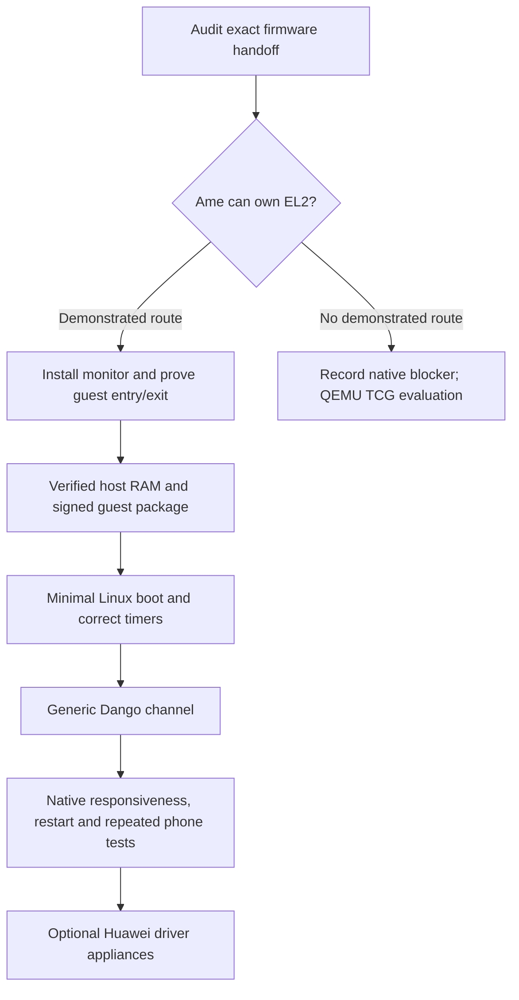

# Dango on the Huawei P20 Lite

Written 14 October 2026 against source revision `4e54cef`. Target: the unlocked
2018 **ANE-LX1 / anne**, Kirin 659, firmware **8.0.0.151(C782)**.

Current implementation scope: a **single-vCPU Linux guest printing hello**.
The [EL2 report and hello workflow](../boards/huawei-anne/EL2.md) track the first
implementation. The channel and driver-appliance phases below remain later work.

The first task is to establish a boot route that gives Ame control of **EL2**.
The verified native route enters at EL1, and the current Dango backend cannot
execute a guest from that entry state. Enabling `dango.manager` or rebuilding
Linux will not resolve this. EL2 access is an open firmware question, so native
completion depends on the outcome of that investigation.

## What counts as functional

The first deliverable is one hardware-virtualized, single-vCPU Linux appliance
running under native Ame, with:

- Authenticated guest artifacts in the signed MXB bundle.
- Linux reaching `dango-agent: started` and executing timed work repeatedly.
- At least 512 ordered host/guest channel round trips, including interrupt wakeup
  and ring wraparound, followed by an ongoing request/reply service.
- Working native console and Mac USB command input while the guest runs.
- A guest fault, stop or restart that leaves native services usable and releases
  its resources.

GPU acceleration, Android, guest SMP and phone peripheral assignment are later
deliverables. The first guest sees a synthetic platform with an emulated GIC,
UART, timer and Dango channel; it does not need Huawei Linux drivers.

## Established baseline and concrete gaps

| Area | Evidence in this tree | Work needed |
| --- | --- | --- |
| Native execution | EL1 Anko, eight host CPUs, framebuffer and signed services are phone-verified; see [board status](../boards/huawei-anne/hardware.md) and [SMP evidence](../boards/huawei-anne/SMP.md). | Establish EL2 ownership on each CPU eligible to run a guest. |
| Recovery virtualization | Saved recovery config has `CONFIG_VIRTUALIZATION=y`, KVM disabled and `CONFIG_HISI_HHEE` disabled. Saved Linux logs say all CPUs started at EL1; bootloader logs report HHEE was not loaded. | Inspect the firmware handoff. These observations establish neither an accessible EL2 monitor nor a way to install one. |
| Dango backend | The first implementation now records per-CPU entry and monitor state; [vCPU execution](../kernel/vm/vcpu.cc) checks the current CPU before HVC. The monitor is non-VHE. | Prove a phone EL2 handoff and actual guest execution; see [EL2 report](../boards/huawei-anne/EL2.md). |
| Host memory | [Anne discovery](../kernel/platform/probe.cc) clamps allocator RAM to 128 MiB. The existing minimal guest needs 128 MiB of backing RAM. | Admit a larger verified host window, account for all reservations and leave room for Ame and payloads. |
| Guest packaging | Linux payloads are optional; Anne embeds `system.mxb` in its native Image. | Include and validate the four Linux artifacts, native footprint and compressed partition fit together. |
| Guest transport | [Manager](../userland/dango/manager/main.cc) maps and tests the Linux channel only for `gpu_profile`. The hello build does not stage the channel driver or enable its agent test. | Make a channel-capable guest independent of GPU assignment. |
| Timekeeping | Native counter rate is 1,920,000 Hz; inherited CNTFRQ reports 16,384 Hz. | Give Linux the measured rate and verify host/guest timer isolation and wall-clock behavior. |
| Observability | [USB acceptance](ANNE_USB.md) records V18 Mac enumeration, CDC input ACKs and `help` output on the panel. Retained fault logs and watchdog keepalive also exist. | Extend this path with guest status and counters; retain bounded recovery captures for early failures. |

The latest recorded device state in the [USB handoff](HANDOFF_2026-10-13-evening.md)
is V18 installed, with stock not restored. Check the actual image and connection
before a future hardware run; older framebuffer notes describe earlier states.
The recovery observations above came from existing private captures, not a new
device inspection. Keep their full logs and identifiers outside version control.

## Dependency order

Host-side memory, packaging and channel work can proceed while the firmware
audit runs. Hardware guest execution must wait for the EL2 gate.

## 1. Resolve EL2 feasibility before scheduling the port

1. Produce a short `boards/huawei-anne/EL2.md` evidence report. Record the actual
   boot and secondary CPU entry levels, MIDR/MPIDR, `ID_AA64PFR0_EL1` EL2 support,
   timer access and PSCI behavior. Add these to existing bounded diagnostics.
   Read EL2 registers only when executing at EL2.
2. Inspect matching vendor startup code and firmware artifacts available from
   verified backups or exact-version official packages. Locate the transition
   into the kernel and determine whether EL1 is selected by the bootloader, an
   EL3 monitor, or another stage. Pin revisions and hashes; another Kirin model's
   implementation is only a research lead.
3. Look for a documented or source-demonstrated way to hand off to an Ame-owned
   EL2 entry point. A chainloader helps only if an earlier stage already gives
   it EL2, or a verified firmware interface can supply that handoff. The current
   EL1 kernel entry cannot promote itself with `ERET`; privilege increases need
   a higher-level exception handler. See [Arm's exception model](https://documentation-service.arm.com/static/67ac57fb091bfc3e0a9479cc).
4. For a credible route, first build a small monitor probe: install private
   vectors and stack, drop to EL1, execute a defined HVC handled by that monitor,
   verify register preservation, then return through the established reset path.
   Preserve native watchdog and retained-trace behavior.
5. Verify the same initialization on the intended runner CPU after PSCI CPU_ON.
   Start with only proven CPUs in the VM affinity mask. Eight working EL1 host
   CPUs do not prove eight usable hypervisor contexts.

**Exit gate:** repeated phone captures prove an Ame-owned EL2 handler accepts a
known host HVC and returns correctly on every selected runner CPU. A CPU feature
bit, successful flash, or `boot_el=2` alone is insufficient.

If the evidence points to a required bootloader/secure-firmware replacement,
record the exact component, image authentication constraints and independent
restore route as a separate firmware project before any such change. The
existing native package replaces only the shared `kernel` partition; it does
not provide a tested restore procedure for lower boot stages. Do not invent SMC
or HVC function IDs from unrelated devices.

If no route is demonstrated, mark native Dango blocked at this gate and use the
evaluation branch below. Do not weaken the kernel's EL2 check to make startup
appear successful.

## 2. Prove the existing VM monitor on Cortex-A53

Changes primarily touch [entry assembly](../kernel/arch/arm64/entry.S),
[EL2 monitor](../kernel/arch/arm64/el2.S),
[VM state](../kernel/include/anko/vm.h) and [vCPU code](../kernel/vm/vcpu.cc).

- Keep the current non-VHE model: Anko at EL1, its monitor at EL2, Linux at guest
  EL1. Audit feature registers, VTCR physical-address size, 4 KiB stage-2 support,
  barriers and CPU errata against the actual A53 revision.
- Represent successful monitor initialization per CPU. Use that state for
  affinity validation and `run_vcpu`, rather than treating the boot CPU's entry
  level as proof for every core. Keep EL1-only native profiles bootable.
- Run a tiny guest that writes only its backing RAM, issues an HVC, traps a
  synthetic MMIO access and attempts an unmapped access. Verify exit reports,
  host register/MMU restoration and rejection of access to host memory.
- Verify IRQ, FIQ and SError exits, host timer restoration and watchdog progress
  while the guest is busy. The guest must return to native scheduling within
  the requested execution budget, even without voluntary HVCs. The current run
  loop checks elapsed budget after `vm_el2_run` returns, and the monitor loads
  guest timer state during entry. Prove an independent host-controlled deadline
  can force that return; add an EL2 timer deadline if needed after verifying its
  interrupt routing. A timer the guest can disable cannot enforce its budget.

**Exit gate:** the guest runs and exits repeatedly on the phone without corrupting
native state. Unsupported traps produce a bounded diagnostic and stop that
guest. Reuse Cortex-A53 EL1/EL2 QEMU runs for regression coverage, but record
phone acceptance separately.

## 3. Provision host memory and a reproducible guest package

1. Add a proposed `huawei-anne-dango` service profile and corresponding native
   and QEMU presets. Begin with nameservice, console, Dango and the existing
   native authority probe. Add the accepted USB/terminal services after the
   minimal guest works. Declare the manager's VM authority and channel
   doorbells explicitly, with GPU authorities omitted.
2. Replace the fixed 128 MiB bring-up clamp with a verified profile limit.
   Evaluate a **512 MiB host window in the captured first RAM bank** initially;
   its size is a candidate, not an assertion that all those pages are usable.
   Avoid needing a multi-bank allocator for the first guest.
3. Audit FDT reservations, reserved-memory cell decoding and ordering before
   allocations. Exclude kernel/BSS, embedded bundle, DTB, firmware/training,
   modem, retained traces and inherited scanout allocations. Check that every
   admitted page has a valid kernel mapping: the current bootstrap RAM map also
   has a 512 MiB ceiling.
4. Measure free pages after native services and payload loading, then after guest
   allocation. Budget 128 MiB guest RAM plus the 16 MiB kernel heap, service
   arenas, bundle, metadata and stage-2 tables, with documented free headroom.
   Exercise low-memory cleanup and fragmented backing allocation; the bounded
   stage-2 record table cannot assume unlimited 4 KiB fallback mappings.
5. Build a pinned Linux source revision and resolved minimal configuration in a
   Linux build environment. Generalize the existing container workflow for the
   hello/channel guest rather than requiring a native macOS kernel build.
   Retain one active vCPU and an initramfs agent; inspect forced-on Kconfig
   options as described in [the appliance policy](LINUX_APPLIANCE_MINIMAL.md).
6. Package `linux/manifest.toml`, `linux/Image`, `linux/initramfs.cpio` and
   `linux/dango-linux.dtb` into the signed `system.mxb`. Use the existing
   `DANGO_LINUX_ARTIFACT_DIR`, profile checks and artifact dependencies. Rebuild
   the embedded Image when the bundle changes.
7. Extend [native packaging](../scripts/anne/build-native-package.py) evidence
   with guest hashes, profile, memory requirements and total decompressed
   footprint. Respect its existing 64 MiB native-footprint bound, Huawei tags
   placement and 24 MiB physical partition/AVB layout. If the guest exceeds a
   bound, design a verified placement change rather than deleting the check.

**Exit gate:** a matching signed package fits all measured ranges; modified,
missing, stale or mismatched guest artifacts fail validation. The native memory
report proves enough backing pages and headroom before guest entry. Keep guest
IPA addresses distinct from phone physical addresses; stage 2 supplies backing.

## 4. Boot Linux with correct virtual devices and time

- Retain the synthetic guest UART/GIC addresses understood by the VM emulator.
  Generate a guest DTB; do not hand Linux the phone's physical DTB. Keep guest
  PSCI HVC handling separate from the host's firmware PSCI SMC conduit.
- Start with the existing hello agent and require actual guest output after
  `starting linux guest`. The manager currently declares Mochi readiness before
  Linux starts, so `init: all services ready` cannot establish guest readiness.
  Add a distinct guest-ready state with a deadline and explicit failure reason.
- Parameterize the guest timer node with `clock-frequency = <1920000>` for this
  phone. Linux v6.12's [architectural timer driver](https://github.com/torvalds/linux/blob/v6.12/drivers/clocksource/arm_arch_timer.c)
  accepts a DT frequency override. Verify its timer banner and repeated
  one-second sleeps against host elapsed time; audit direct CNTFRQ users too.
- Check physical/virtual timer save and restore, CNTVOFF consistency, software
  VGIC delivery, WFI/WFE wakeup and host preemption during guest execution.
  Preserve the existing VM fair-band budget as a starting point: 6 ms per
  16.67 ms period, initially pinned to one monitor-ready CPU.
- Send guest UART output to the existing native log path. Add counters for guest
  entry, exit reason/ESR, timer progress and budget exhaustion without flooding
  the terminal during normal use.

**Exit gate:** Linux launches the agent on the phone, then makes timed progress
for a bounded 60-second capture while native services and watchdog feeds also
progress. This proves runtime beyond the first Linux message.

## 5. Make the Dango channel independent of graphics

The Linux [channel driver](../linux-artifacts/guest-driver/dango_channel.c)
already implements generic SPSC transport without GPU or DMA APIs. Reuse it.

1. Stage it in the minimal guest build, emit its DT binding and device node, and
   compile the standalone channel test into the hello agent. Generalize
   `stage-gpu-source.py`, binding generation and build/check scripts as needed.
2. Give the transport its own manifest/config feature, independent of
   `gpu_profile`. Update manager parsing, channel mapping and host tests to use
   that feature; keep DRM, PCI assignment and GPU staging initialization behind
   the graphics feature.
3. Use one shared ABI source for the channel window and IRQ. The hello manager
   currently names an in-RAM window at `0x47800000`, while the shared minimal
   guest layout names an external channel window at `0x48000000`. Resolve that
   mismatch explicitly in the generated DTB, manifest, bounds and manager;
   prefer the existing external shared-layout window for the new transport.
4. Prove both directions, interrupt-backed wait/arm races, nonzero initial
   counters, wraparound and bounded handling of malformed messages. Check cache
   attributes and release/acquire publication on physical A53 hardware.
5. Add a GPU-independent acceptance runner. The existing
   [channel runner](../scripts/test/channel.py) requires SMMUv3, GPU assignment
   and DRM evidence, so it cannot validate this phone transport unchanged.
6. After the 512-round regression, leave a small status/echo service running in
   the guest and expose native diagnostic commands to query it. Implement and
   document the native command endpoint; do not assume the current shell
   already has Dango controls.

**Exit gate:** 512 ordered round trips and continuing requests succeed on the
phone, with both HVC notification and virtual IRQ delivery evidenced. No PCI,
physical device or DMA-domain grant is required for this gate.

## 6. Integrate normal use and guest recovery

- Combine the Dango profile with the proven Anne USB/terminal service graph.
  Exercise Mac `help` input, log output and guest requests concurrently. Measure
  native command latency and timer progress against a no-guest baseline.
- Add `status`, `start`, `stop` and `restart` operations with explicit state
  transitions and finite deadlines. `dango.manager` currently has `restart:
  never`; do not rely on automatic supervision to recover the appliance.
- Test a guest busy loop, unsupported trap, deliberate guest fault, shutdown
  and channel timeout. Join/stop the runner before reclaiming its VM, channels,
  backing pages and stage-2 tables. Remove pending IRQ/timer references, clear
  stale shared state, then construct the next guest.
- Require ten start/stop cycles with recovered page/object counts, ten native
  boots reaching guest/channel readiness, and a 30-minute mixed idle/busy run
  with responsive native input. These are proposed acceptance targets, not
  claims about present stability. Record power/thermal conditions and any
  firmware resets alongside the results.
- Keep bounded capture packages distinct from normal runtime packages. A
  deliberate watchdog expiry for trace retention must not be mistaken for a
  normal runtime failure or left enabled in the normal profile.

**Exit gate:** retain the exact package, ELF, guest hashes, logs and result JSON
showing successful runtime and recovery. Use the established shared-kernel
restore/checksum procedure before returning to TWRP or Android, as documented in
[boot diagnostics](../boards/huawei-anne/BOOT_DIAGNOSTICS.md).

## Evaluation branch if firmware cannot hand over EL2

Extend the existing [recovery evaluation builder](../scripts/anne/build-recovery-evaluation.py)
to run QEMU TCG with `virt,virtualization=on,gic-version=2`, a Dango-enabled
`qemu-virt` profile, signed guest payload and measured sufficient emulator RAM.
It currently selects `virtualization=off` and the EL1-only Huawei profile; those
settings must change for Dango evaluation. Retain headless serial evidence and
measure nested emulation performance on the phone. QEMU documents this virtual
EL2 option in its [virt platform reference](https://www.qemu.org/docs/master/system/arm/virt.html).

This can demonstrate Dango running on the phone **inside QEMU under TWRP**. It
does not establish native Ame virtualization or Huawei device assignment.
Running software-emulated guests under native EL1 Ame would instead require a
new emulation backend and substantial runtime integration; scope that separately
if native EL2 proves inaccessible. KVM is not an available shortcut in the
captured recovery configuration.

## Later: turn the VM into a Huawei driver appliance

Choose one peripheral only after the VM/channel gates pass. Inventory its
registers, interrupts, clocks, resets, regulators, firmware and bus dependencies;
then define an explicit native/guest ownership boundary and narrow service ABI.
Prefer mediated operations or PIO first where practical. Device DMA additionally
needs the phone's actual IOMMU/domain backend and isolation tests; the existing
PCI/SMMUv3 assignment implementation does not establish Hi6250 support.

Keep the working native USB and framebuffer paths as bring-up tools. A Mali GPU
appliance needs its own driver, memory, power and IOMMU investigation and does
not follow automatically from the QEMU virtio-gpu tests. Guest Linux remains a
minimal driver appliance rather than a full phone OS.

## First implementation batches

| Order | Reviewable result | Required proof |
| --- | --- | --- |
| 1 | EL2 report and bounded entry/capability diagnostics | Exact firmware decision and demonstrated handoff, or an explicit native blocker. |
| 2 | Generic hello/channel artifact build and GPU-independent test runner | Cortex-A53 QEMU Linux boot and ordered channel traffic; existing GPU checks still pass. |
| 3 | Verified Anne RAM limit and packaging checks | Reservation/mapping tests, measured memory headroom and signed package fit. |
| 4 | Monitor readiness, tiny guest and timer adaptation | Native guest entry/exit, host-state preservation and correct Linux timed progress. |
| 5 | Combined USB/Dango profile and runtime controls | Phone channel acceptance, responsive input, restart/resource recovery and soak results. |

Run focused host checks for changed memory, manifest, policy and transport code;
QEMU Cortex-A53 EL1 tests for graceful unavailability and EL2 tests for guests;
then the native acceptance gates. The [Linux ARM64 boot contract](https://docs.kernel.org/arch/arm64/booting.html)
is the reference for EL state, timer access, image/DTB placement and secondary
CPU handoff. Track software tests and hardware evidence separately throughout.
