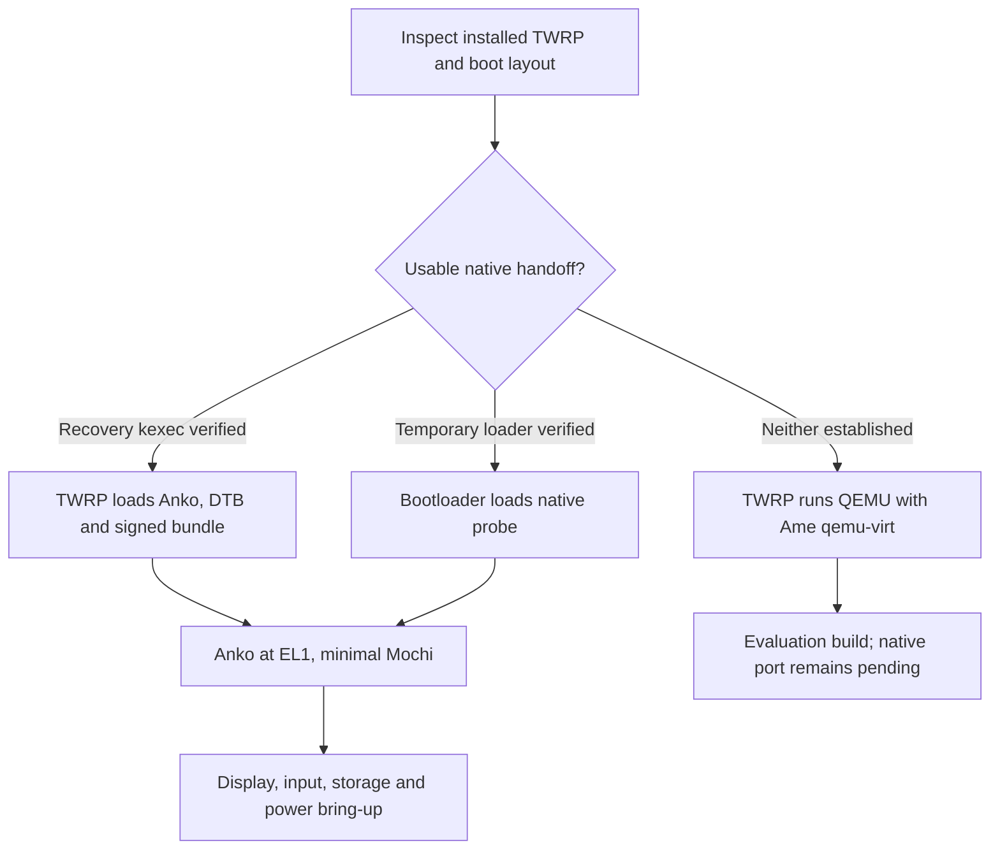

# Ame for Huawei P20 Lite with TWRP

The focused [Dango bring-up plan](HUAWEI_P20_LITE_DANGO_PLAN.md) covers EL2
feasibility, host memory, a signed Linux guest, generic channels and native
runtime acceptance. The verified phone entry is EL1; native Dango first needs
a demonstrated route to an Ame-owned EL2 monitor.

Native eight-core Ressha startup is now hardware-verified: all eight pinned
workers completed on their assigned cores, every core handled timer ticks and
IPIs, and init reached service readiness without faults. See [the framebuffer handoff](HUAWEI_FRAMEBUFFER_HANDOFF.md) for the latest
LED test, artifacts and device state.

Native framebuffer first light is also hardware-verified: `ANKO EL1` and a
green pattern appeared on the panel. D0 scans physical `0x5d000000` as
1080 × 2280 ARGB8888 with stride 4320. Four DFX records confirm display stages,
eight-worker completion, services ready and intentional reset. See
[native framebuffer capture](../boards/huawei-anne/FRAMEBUFFER.md).

Clipping and boot/console integration are also physically confirmed: the inset
`ANKO EL1` heading and scrolling boot/service logs are visible below the notch.
The normal native profile now enables the framebuffer console, with early-log
replay and output from the existing `io.console` service. The bounded console
capture has been phone-tested; the separate normal console image was subsequently
flashed for a demonstration, reached readiness and then faulted on kernel FIQ
vector 6. The firmware source word identified an inherited watchdog timeout.
SP805 keepalive is now phone-verified through a 60-second observation with eight
CPUs ticking and 67 feeds; the capture deliberately expired the watchdog afterward
to retain its trace. Stock is restored and checksum-verified in TWRP. Normal v5
is packaged and unflashed; indefinite uptime remains unverified. See
[watchdog evidence](../boards/huawei-anne/FIQ.md). The latest keepalive validation
passes 42 local checks. The original console validation passed 17 focused host checks and 15 QEMU checks
that decode the actual framebuffer glyphs.

The next native subsystem is planned in [Userspace USB](USB_PLAN.md): generic
host transfers and interface drivers, a Hi6250 DesignWare OTG backend, keyboard
input/terminal work and device-role USB debugging.

Updated 12 October 2026. Native EL1 Anko now reaches
`init: all services ready` on the connected unlocked ANE-LX1, firmware
8.0.0.151(C782). The bounded full-kernel capture retained five identical
`AMEANKO1` records covering all 36 boot checkpoints, MMU enable, the first timer
interrupt, signed bundle authentication, init and the selected `nameservice`
and `io.console` services. No kernel fault, userspace fault or panic was recorded.
The final reset was intentional: `CAPTURE reason=services.ready last=36`.
The stock kernel was restored, its complete SHA-256 verified, and TWRP booted.

The native target embeds LED stage requests, early exception vectors, a private
fault stack, retained console output and fault-register logging. Local validation
found and fixed the embedded bundle's page alignment, and the native clock now
uses the measured 1,920,000 Hz rate instead of the firmware's incorrect CNTFRQ.
136 host tests passed during SMP bring-up; the nine instrumented trace tests
passed again after the LED correction, including EL1/EL2 boot, injected early/MMU
faults and capture reset at service readiness. The current normal build keeps
logging and disables the diagnostic reset-at-readiness option.

The successful phone capture package is `out/anne-boot-trace-package-v2b/`;
private records and checksum verification are under
`out/anne-device-private/boot-trace-v2-test/results/`. See
[Huawei anne bring-up status](../boards/huawei-anne/hardware.md) and
[native boot diagnostics](../boards/huawei-anne/BOOT_DIAGNOSTICS.md).
Longer-running stability, live USB, input and an installable
phone release remain future milestones. Persistent logs are collected over
TWRP ADB after restoring stock; they are not a live native USB driver.

Earlier native attempts had inconclusive output and missing AVB metadata.
The builder now uses the captured Android/Image headers, measured load address
and effective AVB partition size, with locally verified development signatures
and a full stock restore image. Fastboot RAM boot is rejected, so native tests
temporarily replace the shared `kernel` partition. Working TWRP 3.7.0_9-0 and
boot partition backups are available. The recovery kernel has no usable kexec
handoff; the direct unlocked bootloader route is now demonstrated.

The earlier headless evaluation under QEMU inside TWRP remains available as a
separate local testing route. The remaining plan below describes the wider
phone port beyond the now-verified minimal native startup.

## Target and assumptions

This plan assumes the **2018 P20 Lite**, codename `anne`, with an ANE model number.
Huawei lists a Kirin 659 with eight Cortex-A53 cores, 4 GB RAM, a 1080 × 2280
display, and regional storage variants. Confirm the exact model before selecting
device artifacts. The P20 Lite 2019 is a different device and needs its own port.
Sources: [Huawei 2018 specifications](https://consumer.huawei.com/tn/phones/p20-lite/specs/),
[Huawei 2019 specifications](https://consumer.huawei.com/it/phones/p20-lite-2019/specs/).

First identify the phone and confirm which recovery is installed. If TWRP is
present, verify its ADB shell. Record the installed firmware, recovery version,
bootloader state, and partition layout before selecting artifacts. Bootloader
unlocking is outside this port's scope.

The first native release is a development system: boot logs, a portrait terminal,
basic touch and buttons, volatile files, and a tested reboot path. Calls, cellular
data, cameras, fingerprint authentication, audio, Wi-Fi, Bluetooth, accelerated
graphics, and suspend are later projects. Long-running use also requires charging
and thermal management; a successful boot alone does not establish those features.

## What TWRP provides

TWRP supplies a Linux recovery environment for collecting hardware information,
staging files, making backups, and running an installer. It does not make Huawei
Linux drivers available to Anko after a native handoff. Anko's raw ARM64 image is
also not an executable that can be launched as an ordinary recovery process.

The official `anne` page identifies the recovery target as `recovery_ramdisk` and
says this recovery cannot decrypt user data. Use microSD, ADB staging in recovery
RAM, or verified accessible external storage for the first packages. Do not make
access to encrypted `/data` a prerequisite.
Source: [official TWRP device page](https://twrp.me/huawei/huaweip20lite.html).

The official recovery fstab lists distinct `kernel`, `ramdisk`, and
`recovery_ramdisk` partitions. This is evidence for investigating Huawei's split
boot layout, not a guarantee that every firmware has identical boot behavior.
Determine whether normal boot and recovery share the kernel. Replacing a shared
kernel could prevent the existing TWRP ramdisk from booting.
Source: [TeamWin anne recovery fstab](https://github.com/TeamWin/android_device_huawei_anne/blob/android-9.0/recovery.fstab).

## Current Ame baseline

Use the live code and [feature status](FEATURE_STATUS.md) as the baseline. Older
architecture documents describe an inactive `boot/` shim; the current entry is
`kernel/arch/arm64/entry.S` → `kernel_main()`.

| Existing component | Reuse and required work |
| --- | --- |
| AArch64 entry and ARM64 Image header | Already accepts EL1 or EL2. Match the actual loader's physical placement to the linked address. |
| Board selection | Add `boards/huawei-anne/` alongside `qemu-virt` and `switch-t210`; retain the same kernel and service sources. |
| Signed `system.mxb` | Supply it as the external boot payload. Preserve signature validation and `/chosen/linux,initrd-start` / `linux,initrd-end` discovery. |
| DTB discovery and reservations | Extend fixed cell assumptions, memory-bank handling, and device bindings where the captured Huawei DTB requires it. |
| GIC and generic timer | The current interrupt-controller backend is GICv2. Verify the phone's controller, register layout, access, and timer routing. |
| UART console | PL011 and Tegra16550 exist. Verify the Huawei UART binding and clock state before choosing a backend; accessible serial pins are a separate question. |
| Framebuffer and `tty.fb0` | Existing simple-framebuffer support uses Tegra-named fields and tightly packed 32-bit pixels. Introduce generic dimensions, stride, and format handling. |
| CPU support | `kMaxCpus` is four and EL2 stack selection contains four-CPU assumptions. Begin with one core; eight-core support requires a separate topology and stack audit. |
| Service profiles | Extend `userland/system.json`, the current source of board service selection and signed policy. Do not add handwritten legacy manifests. |
| Filesystem and input | `io.fs` currently depends on virtio block, while `ui.input` depends on USB HID. Add explicit phone paths before selecting these services. |
| Dango and device assignment | Guest execution requires Ame to control EL2. The current appliance and SMMUv3/PCI paths do not establish support for Huawei peripherals. |

In particular, setting `DANGO_BUILD_LINUX_ARTIFACTS=OFF` only omits guest payload
construction. It does not remove `dango.manager` from a profile. That service
currently fails when EL2 is unavailable, so the native phone profile must omit it
and its dependent probe until the entry conditions support it.

## Boot strategy

Prefer a native handoff from the working recovery kernel **if its kexec support
and shutdown behavior can be demonstrated**. This lets recovery load Anko, the
signed bundle, and a prepared DTB without changing the shared kernel partition.
TWRP stops running at that handoff; Anko then owns the supported hardware.

If kexec is absent or unsuitable, investigate a supported temporary bootloader
launch with the correct Huawei image format. Do not assume that `fastboot boot`
works, that a conventional `boot` partition exists, or that flashing a ramdisk
changes the kernel. A custom loader is additional work, not an existing Ame feature.



For a kexec route, satisfy the ARM64 boot contract: a valid DTB in `x0`, compatible
register and exception-level state, suitable cache/MMU state, and quiesced DMA
apart from deliberately preserved display scanout. Load the image at its linked
address and reserve all payload and firmware ranges. Recovery framebuffer contents
and ADB availability do not prove either survives the handoff.
Source: [Linux ARM64 boot protocol](https://www.kernel.org/doc/html/latest/arch/arm64/booting.html).

Treat native Dango as unavailable unless the selected route demonstrably gives
Ame control of EL2. Root access in TWRP and ARM virtualization-capable CPUs do not
establish that. Do not build the first phone display or storage path around Linux
driver appliances that need unproven EL2 access.

For the fallback, build a recovery-compatible AArch64 Linux
`qemu-system-aarch64` executable with pinned dependencies. Use TCG initially,
one guest CPU, approximately 256–512 MiB guest RAM, and the existing
`virt,virtualization=on,gic-version=2` machine configuration. Keep Linux appliance
payloads out of this first evaluation package. Package a shell launcher that does
not require the repository's Python tools on the phone. Start with serial logs
retrievable through ADB; a local display/input frontend is a later addition.
TCG performance and process compatibility need on-device measurement. QEMU's
virtual hardware exercises Ame but does not validate the Kirin board port.
Sources: [QEMU Arm system emulator](https://www.qemu.org/docs/master/system/target-arm.html),
[QEMU virt platform](https://www.qemu.org/docs/master/system/arm/virt.html).

## Phase 0 — establish the actual device profile

Collect a reproducible report from the installed recovery before implementing
device constants:

- ANE model, firmware/EMUI version, TWRP version, recovery process architecture,
  and bootloader state.
- Partition symlinks and sizes; original kernel, ramdisk, recovery, and DTB image
  formats; which kernel each boot mode actually uses.
- Running DTB, available kernel configuration, `/proc/iomem`, command line, CPU
  topology, interrupt list, and relevant driver identities.
- Display buffer geometry, pitch, pixel layout, physical allocation when exposed,
  panel/backlight ownership, and behavior on recovery shutdown.
- Touch controller, input events, buttons, buses, clocks, resets, regulator
  dependencies, watchdog, PMIC, battery, and thermal interfaces.
- Whether kexec is built in, permitted, and usable; availability of a supported
  temporary boot route if it is not.

Example read-only observations from a host with Android platform tools:

```sh
adb shell getprop ro.product.model
adb shell getprop ro.product.device
adb shell uname -a
adb shell cat /proc/cmdline
adb shell cat /proc/partitions
adb shell cat /proc/iomem
adb shell cat /proc/bus/input/devices
adb shell ls -l /dev/block/platform/hi_mci.0/by-name
```

The partition path above comes from the official recovery tree; use the observed
path if the installed build differs. Pull `/sys/firmware/fdt` and
`/proc/config.gz` only if present. Missing files are inconclusive. Keep full device
dumps outside the repository, and redact identifiers from shared reports.

Back up every partition a later installer might change, store verified copies
off-device, and document the independent bootloader restore route. Establish that
route before a shared-kernel change is considered. In particular, retaining a
TWRP ramdisk is insufficient when recovery depends on the kernel being replaced.

Deliver `boards/huawei-anne/hardware.md` and a machine-readable device profile with
verified values and explicit unknowns. Pin source revisions and hashes for any
recovery tree, kernel source, or boot-image tooling used in the port.

**Exit gate:** the exact device, boot layout, payload formats, backup artifacts,
and intended native handoff are documented. If no native route is established,
choose the QEMU evaluation package and leave native acceptance pending.

## Phase 1 — prove execution and observability

Create a tiny standalone `anne` handoff probe before loading full Ame. It should
record the entry exception level, DTB pointer, image placement, and boot CPU's
MPIDR. Signal success through a verified UART or a bounded write to a verified
live framebuffer allocation. A memory record can supplement these signals only
if a working method for retrieving it after reboot has been demonstrated.

Never copy a framebuffer address from the Switch port or assume that a visible
TWRP screen remains active after kexec. If shutdown disables scanout, the probe
needs a tested display-preservation path or initial controller bring-up. Account
for boot firmware reservations, secure memory, modem buffers, the display buffer,
and watchdog behavior before writing to memory.

Make the first probe return through a validated reset path, or demonstrate a
reliable manual return to recovery. Native ADB is not an initial logging channel:
the Linux USB gadget stack stops with the recovery kernel.

**Exit gate:** repeated launches show a recognizable probe result, establish the
actual entry contract, and return to working recovery. A host-built image or a
blank-screen reboot is not evidence of native execution.

## Phase 2 — bring up Anko on one core

Add the `huawei-anne` board directory and a proposed `anne-dev` CMake preset. The
preset must remain gated on a complete, verified board profile; no guessed load,
RAM, UART, or GIC addresses should permit a deployable build.

Implement these changes in dependency order:

1. Define image placement and header offsets from the selected loader. Compare
   them with the linked entry, complete image extent including BSS, DTB, and
   signed bundle ranges during packaging.
2. Supply a board fallback containing only verified values. Add a console-disabled
   path if no safe UART is available: early boot currently binds the fallback
   console before DTB discovery.
3. Parse the phone's DT cell sizes, enabled nodes, memory banks, aliases, and
   reservations. Start with a verified contiguous usable RAM window if the
   allocator cannot yet represent the complete memory map.
4. Validate GICv2 compatibility and access, generic timer permissions, and the
   interrupt assigned to the chosen timer. Implement a different backend if
   inspection disproves compatibility.
5. Keep secondary cores off initially. Respect the observed CPU enable method and
   PSCI conduit; do not fall back to QEMU's HVC assumptions on missing data.
6. Bring up allocator, address spaces, capabilities, IPC, scheduler, and signed
   bundle loading. Set QEMU-only devices absent in the board profile.
7. Gate development IRQ and device-assignment self-tests on an explicit test
   profile. The current spare-SPI self-test must not manipulate an unverified
   phone interrupt.

**Exit gate:** native logs establish timer progress, Anko scheduling, signed
bundle verification, and an EL0 service launch without relying on virtio, PCI,
Switch SDMMC, or Dango.

## Phase 3 — make a minimal Mochi phone environment

Add a `huawei-anne` service selection to `userland/system.json`. Start with
`io.console` and `nameservice`; add `io.framebuffer` and `tty.fb0` after display
handoff works. Console mirroring must function even when a hardware UART is
absent. Keep dependencies valid when a driver is omitted.

Extend the environment in small steps:

- **Display:** use preserved scanout for initial bring-up where demonstrated.
  Introduce a generic framebuffer description and capability with validated
  address, size, width, height, stride, and pixel format. Adapt both the kernel
  renderer and Mochi driver; measure rotation and reserve the complete buffer.
  If firmware does not leave scanout usable, a Huawei display/panel driver is a
  prerequisite for the on-screen release.
- **Input:** port the observed touch controller and power/volume buttons using
  its real I²C/SPI/GPIO dependencies. Publish events through Ame's input protocol,
  with coordinate transforms, contact release, and a basic touch keyboard.
  Rework `ui.input` selection so it can consume phone input without requiring
  `drv.usb.hid` or `drv.usb.xhci`.
- **Files:** add an explicit bundle/RAM filesystem mode, with a read-only root
  and volatile `/tmp` and `/data`. Update `io.fs` policy and initialization so
  missing virtio block does not stall boot. Report persistence as unavailable.
- **Shell:** enable `msh` once the filesystem and terminal providers exist;
  retain normal capability and supervision checks.
- **Power:** implement or verify reset/power-off, watchdog handling, battery and
  temperature observation, and the minimum PMIC/regulator behavior needed for
  supervised test sessions. Charging and suspend require separate acceptance.

Omit `dango.manager`, `dango.auth_probe`, `drv.pci`, `drv.blk.virtio`, and the
existing USB host chain from this native profile. Add each only when its actual
phone dependency exists. USB gadget communication needs its own driver; TWRP's
ADB implementation cannot serve a running native Anko instance.

**Exit gate:** native Ame reaches `init: all services ready` for the selected
profile, presents a readable portrait terminal, accepts touch/button input, runs
shell commands, exposes clearly volatile storage, and can return to recovery.

## Phase 4 — package installation and rollback

Initially distribute a directory or ZIP containing the launcher, `anko.bin`,
`system.mxb`, DTB/handoff metadata, a device compatibility manifest, hashes, and
host-readable instructions. Stage to microSD or recovery RAM without changing
partitions. Preserve the existing distinction between development signing and
release keys; record provenance for the complete phone package.

Implement a TWRP-compatible installer only after native acceptance. Its default
mode should validate and stage the package. A separate installation mode may
write an explicitly named, verified target; it must check the device/firmware
profile, original-image hash, partition size, format, and backup before writing,
then verify readback and provide a matching rollback operation. A recovery ZIP
needs an actual compatible installer entry point, not just renamed artifacts.

Where recovery kexec works, investigate a normal-boot launcher ramdisk that uses
the retained Huawei Linux kernel to load Anko. This could preserve TWRP while
making normal boot launch Ame, but ramdisk selection, storage access, and kexec
must be proved on the installed firmware. It is not an Android runtime for Mochi.

If persistent installation instead requires replacing a shared kernel, treat
recovery compatibility as a new boot integration milestone. Do not label that
package reversible until recovery boot and independent restoration have both
been demonstrated.

Huawei image fields must come from verified original artifacts. TeamWin's board
configuration records historical boot-image packaging values, and AOSP documents
versioned headers; neither establishes the correct fields for this particular
installed firmware.
Sources: [TeamWin anne BoardConfig](https://github.com/TeamWin/android_device_huawei_anne/blob/android-9.0/BoardConfig.mk),
[AOSP boot-image headers](https://source.android.com/docs/core/architecture/bootloader/boot-image-header).

**Exit gate:** staging, update, incompatible-device rejection, corrupted-package
rejection, and rollback work on the target without losing the recovery route.

## Later hardware milestones

| Milestone | Dependencies and acceptance |
| --- | --- |
| Durable external storage | Port the observed microSD controller, DMA constraints, clocks, and block protocol. Start with read-only media; use a dedicated Ame area for writes and verify synced data across reboot. |
| Durable internal storage | Separate project after external storage: partition bounds, flush semantics, power-loss behavior, and rollback. Never allocate AmeFS over existing Android files or encrypted userdata. |
| Additional CPU cores | Audit MPIDR-to-logical mappings, GIC target masks, PSCI behavior, all per-core arrays/stacks, and cross-cluster coherence. Test two/four cores before raising the four-CPU limit. |
| USB connectivity | Identify the actual controller and PHY; implement device-mode communication and, separately, any OTG host support. Validate re-enumeration and recovery access. |
| Charging, thermal control, suspend | PMIC/fuel-gauge integration, temperature limits, clock control, interrupt wake sources, and measured power behavior. Required before unattended use. |
| Wi-Fi, Bluetooth, audio, cameras | Device-specific firmware and driver dependencies, bus support, and service interfaces. Working Linux drivers are references, not directly reusable Anko modules. |
| GPU acceleration or Dango appliances | Verified EL2 ownership if using Dango, suitable IOMMU isolation, Huawei device bindings, and a working display path. CPU framebuffer rendering remains the initial baseline. |
| Modem and telephony | Independent large project with firmware interfaces, isolation, networking, audio routing, and radio management. Excluded from the first release. |

## Proposed repository changes

Implemented: the measured profile and hardware notes under `boards/huawei-anne/`,
the `anne-qemu-dev` preset, minimal `huawei-anne` service selection, and these
recovery tools with host regression tests:

```text
scripts/anne/inspect-fastboot.py
scripts/anne/inspect-recovery.py
scripts/anne/build-recovery-evaluation.py
scripts/anne/evaluation-runtime.lock.json
scripts/anne/run-recovery-evaluation.py
scripts/anne/build-native-package.py
boards/huawei-anne/board.cmake
boards/huawei-anne/board_fallback.cc
boards/huawei-anne/native_log.cc
boards/huawei-anne/native_bundle.S.in
boards/huawei-anne/entry-probe/
```

The native additions below remain planned work:

```text
boards/huawei-anne/
  handoff/                    # Small native probe and handoff contract
CMakePresets.json              # Production native preset after acceptance
scripts/build-anne-package.py  # Native phone staging and package validation
scripts/anne/                  # Native launcher, installer/restore
scripts/test/anne-boot.py       # Host capture and device result reporting
```

Modify the live platform parser, framebuffer representation, console bootstrap,
and affected service dependency paths as needed. Keep hardware drivers in the
existing kernel/userland layout and retain shared ABI definitions. Avoid
introducing a second copy of Anko or Mochi for the phone.

## Validation and delivery order

For implementation changes, retain the existing QEMU verification gate and add
focused regressions for the new behavior: Huawei DT cell widths and reservations,
image range overlap, padded framebuffer stride and pixel formats, absent UART,
EL1 service selection, RAM filesystem boot, and installer bounds/rollback.
Fixtures should model captured device properties without including identifiers.

Hardware acceptance should record package hashes, firmware/recovery versions,
entry EL, boot markers, display/input evidence, reset behavior, and repeated cold
and recovery-launched runs. Verify that the original recovery still boots after
each boot integration change. Do not report a QEMU run or a package validation
result as a native phone test.

Deliver in this order:

1. **Device report and boot decision:** completed for the QEMU evaluation route;
   the direct native bootloader route and bounded startup are now verified.
2. **Native handoff probe**, or a clearly labeled **TWRP/QEMU evaluation package**
   when native handoff remains unestablished. The headless evaluation package is
   implemented and verified on the actual ANE-LX1; it reaches service readiness
   and stops the emulator without leaving TWRP.
3. **One-core native Anko and minimal Mochi** with signed payload loading: bounded startup through service readiness is verified; longer-running stability remains open.
4. **Portrait terminal, touch/buttons, volatile files, shell, and safe reset.**
5. **Validated TWRP staging/installer and rollback.**
6. **Persistent external storage and power management**, followed by broader
   hardware support.

Schedule the native implementation after the first two deliverables. Bootloader
behavior, kexec support, surviving scanout, and hardware documentation determine
the effort; TWRP being installed does not settle those questions.
