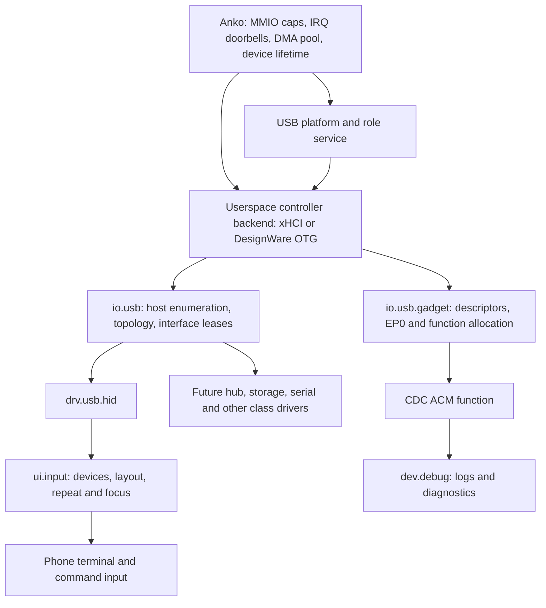

# Userspace USB: host peripherals and native debugging

Implementation roadmap, 12 October 2026. The first usable peripheral is a
USB keyboard on the Huawei P20 Lite. Enumeration, transfers and driver binding
must support other USB classes without changes to controller drivers. Native
USB debugging uses the device role of the same controller, with its own function
drivers. This document defines the work; it does not claim USB hardware bring-up.

## Implementation checkpoint

The portable foundation is implemented. It is not yet the replacement for the
fixed xHCI/HID service wiring:

- Separate v1 host, controller, transfer and gadget ABI headers retain the
  legacy boot-report protocol unchanged. Transfer metadata fits the existing
  48-byte ring payload. Mochi transfer clients/servers expose try-style SPSC
  operations; the host probe checks zero notify/yield calls with active peers.
- `mochi/usb/transfer_engine.h` uses caller-provided registered arenas, flat
  resource tables, dense transfer columns and generational slot pools. Buffer
  slices are registered once and borrowed exclusively. Request lookup uses a
  bounded flat hash index. Normal submission/completion does not allocate.
- The engine validates session/controller generations, endpoint grants, buffer
  direction/ranges and interface-scoped EP0 policy. Cancellation/deadline/session
  closure retains active buffers until hardware completion or stop acknowledgement.
  Completion backpressure retains both results and buffer ownership. Isochronous
  execution and cached non-coherent direct DMA are explicitly unavailable.
- Shared descriptor validation, xHCI rings/TD encoders/event backlog and the
  boot-keyboard decoder have sanitizer probes. The live legacy driver now uses
  the descriptor/ring helpers, preserves unrelated events during control waits,
  rejects truncated configuration/report data, checks SET_PROTOCOL and retains
  reports/key transitions under backpressure. HS/SS interrupt interval decoding
  and ring alignment across 64 KiB boundaries are corrected.
- Kernel-issued xHCI DMA arenas are Normal Non-Cacheable in every CPU alias;
  arena capability metadata reports that attribute. DMA barriers order accesses
  and do not claim to perform cache maintenance. PCI discovery disables bus
  mastering and uses 16-bit command writes, preserving W1C status. Activation
  follows successful DMA registration; release activation requires an IOMMU.
- Each native device has its own IOMMU domain and ownership query. Native DMA
  uses the generic `NativeDevice` DMA class, preserving existing Dango values.
  Failed registration retains potentially reachable pages and refuses activation.

The checkpoint passes all 160 host tests and a two-CPU QEMU keyboard regression
both with and without SMMUv3. The physical Huawei path is unverified. Re-run the
gates after further controller, lifecycle or ABI changes.

The new transfer ledger is tested with deterministic hardware completion/stop
injection, but it is not yet connected to the live xHCI transfer service. That
connection, separate `io.usb`/platform services, controller/session provisioning,
timed sleeps and IRQ routing, Huawei IOMMU/DesignWare bring-up, report-protocol
HID, per-source input v2, and executable gadget/CDC support remain to implement.
No new controller/gadget protocol is advertised as a working service yet.

Validation commands:

```sh
python3 -m unittest discover -s tests -p 'test_usb.py'
python3 -m unittest discover -s tests -p 'test_mochi_ring.py'
cmake --preset qemu-dev -B out/usb-qemu-dev -DMOCHI_USB_TRACE_INPUT=ON
cmake --build out/usb-qemu-dev --target anko mochi_system
python3 scripts/test/usb-input.py --build out/usb-qemu-dev --cpus 2
```

The last check sends repeated virtual keys, releases and a modifier chord through
QEMU's actual xHCI/HID path. Its input trace is development-only and disabled by
default. The test uses a local Unix monitor socket and no physical USB device.

## Existing code and phone evidence

`userland/drivers/usb/xhci/main.cc` already runs in userspace and maps controller
MMIO and a DMA arena. It combines root-port enumeration, configuration parsing,
HID class requests, one global keyboard and eight-byte interrupt reports. It
polls the event ring even though kernel IRQ-to-doorbell delivery exists. The
running USB service path still exposes only boot-keyboard reports; the new
general contracts are not yet used by that service path.

`drv.usb.hid` decodes that report into key transitions; `ui.input` supplies US
layout translation. Both keep one input source, and their manifest channels are
fixed. There is no native Huawei USB backend. The normal Huawei service profile
currently selects only `nameservice` and `io.console`.

The captured phone DTB and matching vendor source identify the board path:

| Resource | Recorded evidence | Still to establish natively |
| --- | --- | --- |
| Controller | `hisilicon,hi6250-usb-otg`, `0xff100000`, DT window `0x40000` | Core ID/revision, hardware parameters, FIFO/channel/endpoint limits and current role |
| Interrupt | DT `<0 0x9f 4>`: SPI 159, derived GIC INTID 191, level high | Delivery, source clearing and re-arm on the phone |
| PHY description | `hisilicon,hisi-usb2phy`, `0xfe000000`, DT window `0x100000` | Actual register ownership and initialization dependencies |
| USB AHB interface | `hisilicon,usb-otg-ahbif`, `0xff200000` | Exact register window needed by the backend/platform operations |
| Board setup | Vendor Hi6250 glue uses PCTRL, CRG clocks/resets, an OTG supply and different host/device PHY tuning | Bounded startup/shutdown sequence preserving display, timers and other shared resources |
| Connector and power | DT contains Type-C/switch/charger alternatives and OTG event plumbing | Which chips are actually fitted/bound, cable/orientation detection, VBUS sourcing and shutdown |

The matching glue describes **DesignWare OTG 2.0** and matches the captured
compatible string. A DWC2-family backend is the working choice; validate the
native core ID before programming it. The existing xHCI backend remains useful
for QEMU and supported xHCI boards. Source provenance is pinned in
`out/anne-usb-research/sources.json`, at commit
`65e545cbaa11d132e243287b150146bc2a51c45e`.

DT alternatives are discovery leads, not proof that every listed chip is
installed. Start the hardware inventory from recovery's bound drivers and the
actual board wiring. TWRP ADB and fastboot are recovery/bootloader transports;
their stacks do not continue running under native Anko.

## Ownership and service boundaries

Keep USB protocol handling in userspace, including the controller engines.
Anko supplies resource capabilities, interrupt delivery and DMA memory. Shared
clock/reset/power registers need a small USB-specific platform operation until
reusable userspace clock/regulator services exist; avoid giving a class driver
the shared CRG/PCTRL pages.



Host and gadget services are role-specific clients of one physical backend;
they never drive the port concurrently. Proposed responsibilities:

| Component | Owns | Does not need |
| --- | --- | --- |
| Anko | MMIO grants, SPI binding, pinned DMA pool, shared-memory policy, ownership teardown | USB descriptors, HID usages or class selection |
| USB platform/role service | Connector events, board PHY sequence, VBUS budget, role transitions and recovery | Keyboard reports or terminal layout |
| `drv.usb.xhci` / `drv.usb.dwc2` | Controller registers, queues/channels/FIFOs, IRQ source handling, DMA and transfer completions | USB class drivers, text translation or debug commands |
| `io.usb` | Host enumeration, addresses, configurations, topology, interface binding and permitted EP0 requests | Controller register layouts |
| `drv.usb.hid` | HID descriptors, input/output/feature reports, usage events and keyboard LED reports | Controller MMIO, physical addresses or Unicode layout |
| `ui.input` | Input-device state, keymap, repeat, routing and disconnect releases | USB packets |
| `io.usb.gadget` | Device-role descriptors, standard setup requests, endpoint allocation and function lifecycle | Debug command semantics |
| `dev.debug` | Log subscriptions, diagnostic queries and explicitly granted development controls | PHY/role control or controller MMIO |

A controller process is trusted because it can program DMA. Class and gadget
function processes receive scoped IPC sessions and bounded payload memory.
Interface ownership is enforced by `io.usb` using existing capabilities and
session generations; a new kernel USB capability type is not required initially.

## General USB contracts

Define separate, versioned protocols for class-to-host, host-to-controller and
gadget-to-controller traffic. Share descriptor definitions, transfer types,
status codes and payload-buffer rules; keep host enumeration and gadget EP0
semantics distinct. Keep the old boot-report protocol intact until the QEMU
chain has migrated. Do not reinterpret its opcode 1 as a new request format.

Use the existing 64-byte `MxRingSlot` and request/reply sessions. Control metadata
must fit the 48-byte inline budget, checked with static assertions. Descriptor
blobs and transfer payloads use bounded, per-session shared arenas. Define byte
order, ABI version, required/optional feature bits and descriptor-size limits
before assigning message layouts.

Host-facing operations:

| Operation | Contract |
| --- | --- |
| Negotiate / controller capabilities | Supported roles, speeds, transfer types, payload limits and topology features; explicit unsupported results |
| List / watch | Snapshot plus sequenced attach, detach and reset events; recover from overflow by resnapshotting |
| Read descriptors | Validated device/configuration/interface/alternate/endpoint tree, plus bounded access to retained raw descriptors |
| Claim / release interface | Lease bound to caller session, device generation and interface; matching by class/subclass/protocol, with optional specific-device policy |
| Open / close endpoint | Opaque endpoint token from a claimed interface; validate direction, type, packet size and active alternate setting |
| Control | USB setup packet plus payload reference; serialize EP0, mediate interface class/vendor requests and reserve device-wide configuration/address changes for the bus service |
| Submit / cancel | Asynchronous control, interrupt or bulk request; request ID, endpoint token, buffer ID/offset/length, flags and monotonic deadline |
| Completion | Request ID, status and actual byte count; short transfers are represented explicitly |
| Alternate setting / clear halt / reset | Mediated operations with cancellation and generation rules; device reset requires wider authority than an ordinary interface lease |

Reserve isochronous transfer representation and capability negotiation, but
return unsupported until scheduling and per-packet results are implemented.
Audio/video support will need bandwidth admission and per-packet timing/status;
it must not be implied by a generic submit opcode.

Tokens are opaque and session-scoped. Never put a userspace pointer or arbitrary
physical address in a class-driver request. Publish topology as controller plus
port path and generation, rather than treating a reused USB address as identity.
Composite devices can bind different interface drivers; grouped functions can
claim interface groups atomically when needed.

An accepted transfer has exactly one terminal result while the session lives.
Cancellation can race normal completion; it does not make the buffer immediately
reusable. Detach, reset, role change and controller restart revoke affected
tokens, stop transfers and report cancellation/disconnection. A dead session is
closed and its buffers remain quarantined until hardware access has stopped.
Bound devices, endpoints, descriptor bytes, in-flight requests and queued events.
A full queue returns backpressure; it must not lose ownership of a DMA buffer.

The controller contract includes root-port status/change events, port reset,
device creation/addressing, endpoint setup, transfer submission/cancellation and
controller quiescence. Addressing is a backend operation: xHCI uses its Address
Device command while the DesignWare backend performs the appropriate USB
control exchange. The host service must not issue a second SET_ADDRESS blindly.
Controller event dispatch must handle all active endpoints while commands and
control requests are pending, rather than discarding unrelated events.

## DMA, interrupts and restart behavior

Use Anko-allocated, bounded DMA pools with verified device address widths and
bus-address mappings. Hardware queues remain backend-private. Per-client payload
pools have separate CPU capabilities and stable mappings in the controller's
isolated domain. Use direct DMA for eligible pools; expose bounded bounce copies
as an explicit fallback for hardware constraints. Neither mapping nor allocation
belongs on the normal submission path. Scatter/gather remains a negotiated later
capability without changing buffer ownership semantics.

Coherency is a bring-up gate. The current xHCI service's barriers and exposed
physical arena are not proof of coherency on Kirin. A practical first policy is
one pool registered as Normal Non-Cacheable before userspace launch, using the
existing physical-range attribute machinery for every alias. Confirm that
controller accesses work with this mapping and keep ordering barriers. If cached
DMA is later needed, add capability-scoped synchronization for validated ranges.

Bind the owned SPI to a doorbell using the existing IRQ syscalls. The userspace
backend drains device status, clears the interrupt source and calls ACK to
re-arm a level-triggered line. Use polling for bounded initial identification,
then make the normal stack event-driven, with explicit transfer deadlines and
no indefinite waits for an unplugged device.

Process exit currently removes IRQ bindings; that alone cannot stop DMA.
Introduce device-lifetime fencing: stop/mask the controller and confirm quiescence
before reusing its DMA pool or restarting its owner. Shared board reset actions
may need the small Anko platform hook. If quiescence fails, quarantine the pool
and leave the controller offline. Preserve framebuffer logs and other services
when USB fails. A backend is ready when its engine can accept work; readiness
must not depend on a keyboard being attached.

## Keyboard and phone input

Move all HID assumptions out of xHCI. The HID service claims an interface and
submits ordinary endpoint transfers through `io.usb`.

First bring-up may use the HID boot-keyboard protocol when the interface advertises
it and SET_PROTOCOL succeeds. Check report lengths and rollover/error usages;
keep previous state per device/interface. Then add a bounded report-descriptor
parser for report IDs, array/variable fields, modifiers and keyboard usages, so
ordinary report-protocol and composite keyboards work. Implement keyboard LED
output through normal output/control requests. The HID specification distinguishes
these two protocols; the boot format is an initial class-driver feature.
[USB-IF HID specification](https://www.usb.org/sites/default/files/documents/hid1_11.pdf)

Version the input contract to identify source device/generation, usage page and
usage, with attach/detach/resynchronization events. Keep text conversion, repeat
and focus in `ui.input`; choose layout by policy instead of fixing the USB ABI
to US ASCII. Detach or loss of an event stream releases held keys/modifiers.
One keyboard reconnect must not affect another source. Add mouse/pointer events
when the HID parser supports them; the USB host contract already works for them.

The working Huawei framebuffer console is currently kernel-owned and output-only.
Keyboard input needs a consumer. First use a small userspace input observer that
logs decoded events through the existing console. This proves physical input
without pretending that a shell or the existing `tty.fb0` is already available.

For a usable portrait terminal, expose the validated Huawei framebuffer to
`io.framebuffer`, derive terminal geometry/insets from it, and add an explicit
ownership handoff from the early kernel renderer. Keep retained logging active
and route normal visible output through the terminal after handoff. Preserve the
notch margins and DMA publication policy; do not create conflicting cached and
uncached framebuffer aliases or two simultaneous pixel writers. The existing
`tty.fb0` assumes 1024×768, and `msh` starts after `io.fs`, whose phone block path
is not ready. Provide a volatile command console or decouple shell startup from
persistent storage before promising keyboard-driven shell use.

## USB device role and debugging

The same phone port can host a keyboard or appear as a device to a computer.
Those roles require separate protocol paths and cannot operate simultaneously
on this controller. A normal USB hub does not make the phone a peripheral and a
host at once. Keep role management explicit: detached, preparing host/device,
active host/device, quiescing and fault. A transition drains/cancels transfers,
revokes leases, handles VBUS ownership, changes the controller/PHY role, then
enumerates the new side. Add automatic cable-driven transitions after the fitted
connector controller and power sequencing are verified.

Build a generic gadget function interface that registers bounded descriptors,
declares endpoint requirements and receives setup/reset/configuration events.
The gadget core handles standard EP0 requests and allocates real endpoints from
backend capabilities. Function drivers queue/cancel transfers through opaque
endpoint tokens. Share transfer lifecycle rules with the host API, rather than
sharing host-specific enumeration operations. This follows the hardware-neutral
endpoint/function separation described by the
[Linux gadget API](https://docs.kernel.org/driver-api/usb/gadget.html), adapted to
Ame's userspace services.

Start with a **CDC ACM serial function**: live log output and a development
diagnostic command console on the connected Mac. Implement its control/data
interfaces, class requests, line-state handling and notification endpoint.
Verify host enumeration and repeated reconnects on macOS, then Linux. CDC ACM
provides a standard serial transport; use the
[USB-IF CDC definitions](https://www.usb.org/document-library/class-definitions-communication-devices-12)
and [serial gadget documentation](https://docs.kernel.org/usb/gadget_serial.html)
as interoperability references. Select appropriate development VID/PID and
descriptor identity before hardware enumeration.

`dev.debug` subscribes to a log fan-out from `io.console`; it must not become a
second competing reader of kernel log rings. Replay a bounded early-log snapshot
once userspace USB becomes ready, then stream sequenced live records. Host
backpressure drops debug copies with a reported gap; it never blocks boot or
framebuffer logging. Begin with read-only boot stages, USB topology/transfer
statistics, scheduler counters and named diagnostic snapshots. Add explicitly
scoped reboot/trace controls only to the development profile.

This is native Ame debugging, not Android ADB. If structured tooling is needed,
add a framed vendor bulk function beside ACM with version, channel, sequence,
length, request ID and bounded payloads. Log and diagnostic channels can share
that framing; future debugger traffic need not alter USB controller code.

A userspace USB service cannot promise output before it runs, during a kernel
panic, or while all CPUs are halted. Keep retained DFX/ramoops diagnostics. A
later GDB stub needs kernel task/register inspection and a plan that keeps the
USB service schedulable during debug stops; full all-core halt would require a
different debug execution arrangement or a small polled crash transport.
Treat that as a separate milestone from live logs and a command console.

## Implementation order and acceptance

| Step | Work | Acceptance gate |
| --- | --- | --- |
| 1. Hardware inventory and contracts | Identify fitted connector/power devices from recovery; pin board/controller evidence; define versioned host/backend/gadget ABI and fake backend | Bounded descriptor parsing and lifecycle tests; resources, DMA attributes and role dependencies documented without phone writes |
| 2. Generalize existing xHCI | Extract enumeration into `io.usb`; replace global keyboard state with devices/endpoints/transfers; migrate HID to interface sessions | QEMU keyboard still works; composite/non-keyboard descriptors enumerate; short transfers, detach/reconnect, cancellation and multiple endpoints pass |
| 3. Native platform and controller | Add Hi6250 resource grants, board USB operations, low-memory DMA pool and userspace DesignWare backend | Bounded core-ID/role/port and EP0 captures, real IRQ delivery, verified DMA, controlled reset and stock restore; no display/SMP regressions |
| 4. Native keyboard | Enable host role, correct VBUS handling, generic enumeration, HID and input observer | Key down/up/modifiers appear on the phone; detach while held releases state; reconnect works; idle USB does not busy-spin |
| 5. Usable terminal and wider peripherals | Phone framebuffer ownership/geometry, volatile command input; report-protocol HID; hub topology and scheduling | Interactive typing below the notch; second keyboard or mouse does not require HCD changes; no input state lost on reconnect |
| 6. Native USB debugging | Device-role EP0/gadget core, CDC ACM and nonblocking log/diagnostic service | Mac enumerates native Ame; early replay/live logs and diagnostic requests work; reconnect/backpressure and role transition tests pass |
| 7. Additional classes and debug tooling | Hub split transactions where needed, storage/serial classes, framed debug bulk channel; debugger inspection later | Per-class tests and driver restart recovery; bulk traffic works without changing the shared transfer contract |

Steps 1–2 can proceed before phone controller bring-up. After step 3, gadget
debugging can proceed alongside keyboard/terminal work if live development logs
become the higher priority. External hub support is a separate acceptance gate:
low/full-speed devices behind a high-speed hub need transaction-translator and
split-transaction handling on DesignWare. An initial direct-attach keyboard
milestone does not establish that support.

Before physical trials, add meaningful host tests for malformed/truncated
descriptors, HID reports, token/session isolation, queue pressure, deadline and
completion/cancellation races. Use a fake controller for generic transfer
semantics and gadget EP0/control-state tests. QEMU xHCI validates the shared host
layers; it does not validate Kirin PHY/power/DMA or the phone's gadget hardware.
Test controller death with pending I/O, repeated plug/unplug, unknown devices,
STALL recovery, short/ZLP transfers and role changes. Pin explicit bounds for
each diagnostic capture. Keep stock restore/checksum verification and tagged
DFX collection as the recovery path until native USB is independently proven.

## Expected source changes

| Area | Planned changes |
| --- | --- |
| `shared/include/midix/abi/protocols/` | Versioned USB host/controller/gadget definitions and input v2; transfer/control/descriptor types |
| `userland/lib/include/mochi/` | USB clients/servers, payload-buffer helpers and device-aware input endpoints |
| `userland/drivers/usb/` | General xHCI backend; new DesignWare backend; host bus service, HID parser, hub service and gadget functions |
| `userland/drivers/input/`, `tty/`, `framebuffer/` | Source-aware input and policy, phone geometry, framebuffer ownership and command input |
| `userland/console/`, new debug service and host tool | Log fan-out/replay, CDC diagnostic console and optional framed bulk client |
| `kernel/platform/`, `kernel/init/boot_caps.cc`, `kernel/mm/`, device teardown | Verified controller resource description, IRQ/DMA grants, DMA attributes and USB ownership/quiescence hooks |
| `boards/huawei-anne/` | Pinned USB evidence, board platform operations, role/power sequencing and tagged diagnostic checkpoints |
| `userland/system.json`, build/profile scripts | Separate host-input and device-debug profiles, scoped sessions/arenas and restart policy |
| `tests/` and phone capture scripts | Fake USB backend, parser/ABI/lifecycle tests, QEMU regressions and bounded native captures |

Start with separate development profiles rather than enabling every dependency
in the normal phone profile at once. A keyboard, live debug serial transport and
a full USB ecosystem have different acceptance gates, while sharing the same
general transfer and lifecycle interfaces.

Hardware source references:
[Hi6250 OTG glue](https://github.com/hisi-oss/android_kernel_huawei_hi6250-8/blob/65e545cbaa11d132e243287b150146bc2a51c45e/drivers/usb/susb/dwc_otg_hi6250.c),
[board/power integration](https://github.com/hisi-oss/android_kernel_huawei_hi6250-8/blob/65e545cbaa11d132e243287b150146bc2a51c45e/drivers/usb/susb/dwc_otg_hicommon.c),
[DesignWare core driver](https://github.com/hisi-oss/android_kernel_huawei_hi6250-8/blob/65e545cbaa11d132e243287b150146bc2a51c45e/drivers/usb/susb/dwc_otg_driver.c).
The interface/configuration/endpoint layering also has a reference in the
[Linux USB host API](https://docs.kernel.org/driver-api/usb/usb.html).
