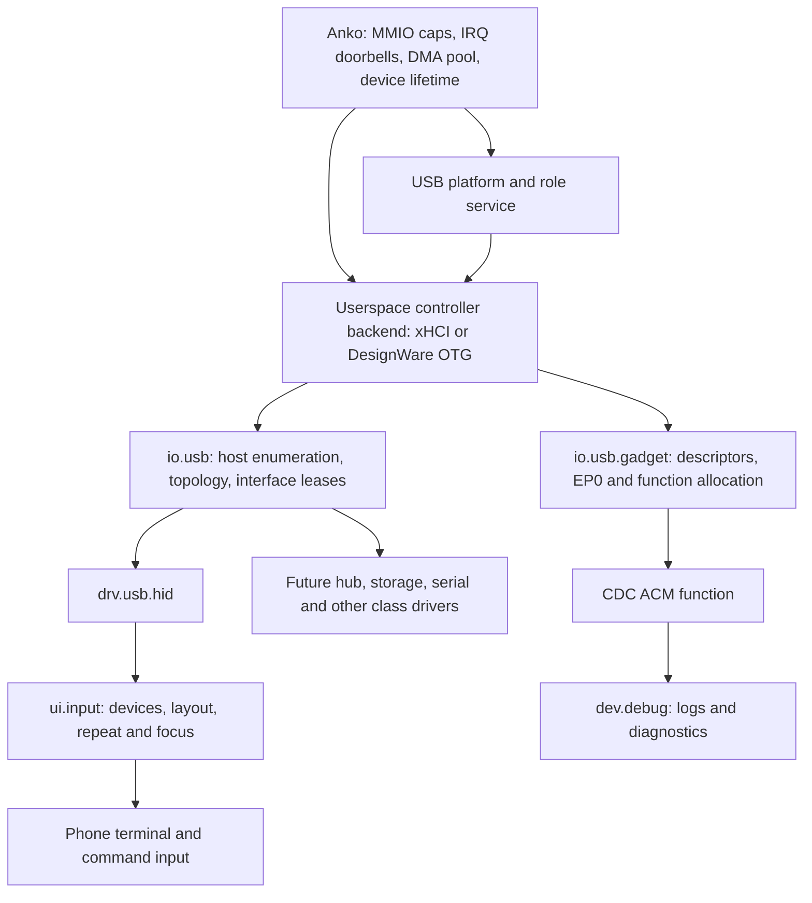

# Native USB, input and serial

The [architecture](architecture.md#native-service-lifecycle-and-user-interaction) describes the current service boundaries. Begin with the native guide and serial protocol; dated audits and the original roadmap follow. Later phone profiles include eMMC/AmeFS and Dango, superseding early notes about filesystem-free shells. Recorded CDC operation does not establish that all reconnect issues are resolved.

The 28 October source audit identified controller ordering defects independent
of the earlier RX-status hypotheses. An aborting SETUP started a TX FIFO flush
inside the RX drain, which then continued popping RX entries and filling other
IN FIFOs while TXFFLSH was still set. The pinned Hi6250
[GRSTCTL definition](https://github.com/hisi-oss/android_kernel_huawei_hi6250-8/blob/65e545cbaa11d132e243287b150146bc2a51c45e/drivers/usb/susb/dwc_otg_regs.h#L383)
requires the application to wait for completion before other operations; its
driver also waits three PHY clocks afterward. The corrected asynchronous path
waits for the EP0 reader to stop (disabled or NAK-effective), AHB idle, flush
completion and PHY settling before resuming controller I/O. Role changes defer
quiescing while a flush is pending. Initial FIFO-layout logging was moved after
flush/settle completion, and the shared core reset also observes the post-flush
interval.

A held-flush production-executor regression fails on the old code because it
accesses controller registers/FIFOs during the flush. It checks delayed NAK and
AHB acknowledgement, retained SETUP data, another function's pending IN packet,
role changes and recovery after the settle interval. A separate capacity
regression exposes partial TX packet writes; SEND now waits for the complete
packet to fit, consistent with the vendor and Linux PIO packet writers.
These are verified code/contract defects. They have not yet been established as
the cause of the phone's RX-status corruption. No device test or flash was run
for these audit changes.

During the PanVK CTS runs, control/vendor USB requests remained responsive while
the CDC shell stalled. A host-model regression reproduces a deadlock: the gadget
only consumed ACM control replies while no bulk IN packet was outstanding, so a
port-open request could wait on the data transfer it needed to restart. ACM now
has independent control request/reply rings, and gadget always consumes them.
Tests cover a held bulk packet and both blocked byte directions; the data stays
owned until its ordinary completion. The v22 graphics gate passed, but a serial reopen still failed, so this was not
the whole hardware fault. v24 adds bounded vendor EP0 state reads (0x5a gadget,
0x5b one controller endpoint) without arbitrary address access. A failed reopen
reported control phase OUT, `SET_LINE_CODING`, seven expected bytes and zero
received, with empty CDC data queues. The host baud ioctl took 5.5 seconds.

A model of retained SETUP credits suggested rearming the control-data window.
That inference was not established by the original hardware snapshot: requesting
the snapshot itself first submits a new SETUP. Both the broad rearm in v25 and
the OUT-only rearm in v26 regressed physical enumeration. The host creates CDC,
then HID probing times out and enumeration repeats. The live-window rewrite has
been removed, and its unsupported model-based OUT assertion was removed too.
v29 restores the previous transfer behavior and adds vendor request 0x5c, which
returns a bounded controller trace retained from before diagnostic SETUPs. It
records the original SETUP identity, OUT registers at SETUPDONE and RECEIVE,
last RX status, software flags and accepted DATA OUT byte count. The trace
survives diagnostic reads in regression tests. On v29 the retained trace captured
`SET_LINE_CODING` with a live 16-byte OUT window, EPENA and NAKSTS set, and no
DATA bytes. v30 tried clearing NAK with CNAK when RECEIVE adopts that window,
without rewriting its size. Backup and full readback passed, but enumeration
failed before CDC became available. v31 restricted CNAK to nonempty OUT data
receives and also failed enumeration after verified flash. Both variants are
rejected despite passing model/sanitizer checks; source restores v29's live
window behavior. The v32 candidate retains the separate Mesa comparison fix
with that USB baseline. The rejected NAK experiment is retained in
`out/panvk-completion/usb-data-nak-v31-rejected.patch`; the reopen fault remains
unresolved.

v32 confirms the retained failure: SET_LINE_CODING reaches validated RECEIVE
with OUT control `0x80028000` and size `0x40080010` (NAK, enabled, 16 bytes left
from SETUP credits). Temporarily detaching the CDC host driver and issuing the
class requests directly isolates this from termios: GET_LINE_CODING succeeds,
SET_LINE_CODING times out, and another GET succeeds. The host driver was
reattached afterward; evidence is in `usb-control-detached-v32/` under the
PanVK output directory.

The pinned vendor PIO reference distinguishes `ep0_out_start` (preserves an
enabled SETUP window) from `dwc_otg_ep0_start_transfer` (programs a full-packet
OUT window, orders MMIO, then CNAK/EPENA). v33 applies that complete transition
at validated RECEIVE, after SETUP interrupt acknowledgement. It preserves an
already prepared full-packet non-NAKed window and already admitted early bytes.
This differs from v25/v26's changes at SETUPDONE and v30/v31's CNAK-only change.
New DATA and STATUS regressions reject the v32 behavior and host checks pass,
but v33 also fails enumeration. Host journal evidence shows CDC detected,
then a HID probe timeout (`-110`) and whole-device re-enumeration. The transition
is therefore insufficient and remains experimental; the root-owned USB node
during probing prevents unprivileged retained-state capture. Reference copies
and hashes are in
`out/panvk-completion/vendor-dwc2-reference/`.

v34 restores the v32 baseline by default. Explicit vendor request 0x5d arms
one nonempty EP0 OUT receive: value 0 cancels, 1 tries CNAK alone, and 2 tries
full-window programming followed by CNAK. It accepts no register address or
arbitrary register value. A bus reset or role teardown clears the trial; STATUS
OUT does not consume it. Existing observations 0x5a–0x5c remain read-only.
`scripts/anne/usb-ep0-trial.py --mode MODE --output UNIQUE_PATH` detaches only
the CDC control driver, arms one trial, sends the seven-byte class request,
captures retained state before cleanup, cancels any unused arm and reattaches
the driver. History flag bit 9 identifies post-programming RECEIVE registers;
bits 10:11 record the consumed mode. v34 enumerates, passes the 51-case graphics
matrix, 38 Vulkan frames and 296 GLES frames with restoration and no faults.
Its baseline trial receives zero bytes and times out. The first CNAK-only
trial delivers seven bytes to ACM but the host sees STALL in 4 ms. The full-window
trial disconnects; baseline enumeration recovers afterward. These observations
do not establish a fix. Evidence: `usb-trial-v34-*` under the PanVK output tree.

v35 adds read-only request 0x5e: a 48-byte retained class snapshot containing
magic `ACS1`, type/request/expected length, index/value, received byte count,
signed function reply status, reply byte count, request id, and the 16-byte
class payload. It retains the last completed DATA OUT request across later
SETUPs. The trial tool reads it before cleanup to distinguish corrupted data,
class rejection and status-handshake failure. Production controller/gadget/ACM
round-trip and snapshot tests pass. v35 passes the selected graphics gate, but
its first CNAK trial disconnects before the class snapshot can be read. The
snapshot after re-enumeration is empty; that alone does not establish a process
crash or kernel fault.

v36 adds read-only request 0x5f for a frozen window of the last 8 KiB of the
retained kernel log. `scripts/anne/usb-log-tail.py` reads its metadata and bounded
64-byte pages. Controller exits for an oversized RX status or a SETUP TX-flush
timeout emit `USB_EP0_FAIL` markers. The default transfer behavior remains the
v32 baseline. The verified v36 installation passes the selected graphics gate:
51 supported cases, two S8 skips, 37 Vulkan frames and 296 GLES frames, with
display restoration and no captured GPU fault markers.

On v36, the log reader works before the one-shot CNAK trial. SET_LINE_CODING
then returns STALL in 3 ms, and all later EP0 observations time out. A fresh
bulk keyboard exchange still succeeds after those failures, so the controller
executor, gadget and bulk input processes were making progress at that point.
A subsequent device-only USB bus reset fails to restore enumeration. The user
reports that the phone's CPU/battery status values continue changing while USB
is absent. These updates require periodic kernel health reads, TTY scheduling
and framebuffer service, ruling out a complete kernel freeze during those
updates. They do not exclude one stalled CPU, a blocked USB thread, or a missed
kernel wakeup. The root cause remains unresolved; EP0 failure alone is not
evidence of a global kernel stall. A physical replug at 17:28 UTC restores
enumeration and all diagnostic reads on the same kernel boot. The recovered
log records role detach/reattach, with no captured panic or `USB_EP0_FAIL`.
The retained class snapshot contains seven bytes `00 00 08 63 00 00 67`,
rejected with `MX_ERR_NOT_IMPLEMENTED`; the invalid data-bit value is 0x67.
Its request id is 17, so this older retained request cannot yet be attributed
to the later one-shot trial. The receive-data origin remains to be established.
CDC registration after replug does not establish a working shell reopen.
Artifacts are under
`out/mesa-panvk-midgard/usb-trial-v36-cnak-115200/` and
`out/mesa-panvk-midgard/usb-v36-after-replug/` and
`out/panvk-completion/{usb-v36-before-trial.log,usb-v36-after-replug.log,bulk-v36-alive.log,reset-v36-usb.json}`.
These are diagnostics, not a proven USB fix.

After replug, v36 completes one interrupted-log/reopen challenge. The following
eight-iteration run fails before completing its first iteration. Its recovered
kernel log now contains `USB_EP0_FAIL rx_status_exceeds_packet_scratch` followed
by service restarts; the kernel boot continues. This establishes a controller
service exit for that reproduction rather than a complete kernel stall.
The first successful run retains valid 9600/8-bit line coding accepted by ACM,
so the earlier invalid retained payload is not evidence that every transfer is
corrupted. Evidence: `usb-reconnect-v36-after-replug*` and
`out/panvk-completion/usb-v36-after-reopen-failure.log`.

v37 changes RX FIFO handling to consume bytes only for OUT DATA and SETUP DATA
status entries. The previous code used the byte-count field before inspecting
the status type, including for completion/NAK entries. Both the pinned Hi6250
vendor driver and Linux DWC2 gadget driver restrict FIFO reads by status type.
A production-executor regression with nonzero status-only count fields fails
the old source and passes the new source; sanitizer checks and an ARM64 QEMU
probe pass. The image also logs the raw word on oversized payload failures and
the first status-only entry carrying a nonzero count. This is a candidate fix:
v36 did not record the failing raw word, so its packet type is still unknown.
The v37 package was installed with backup and full partition readback verified
(`out/anne-device-private/kernel-install-20261027T204001Z/result.json`, SHA-256
`8d17775e7a0c79ca2df719b9aceb62c7b05ae2014ccc6d13ebfa1a6462b3e072`).
The selected graphics gate passes 51 supported cases with two S8 skips, 38 Vulkan
frames and 295 GLES frames with display restoration and no captured GPU faults.
All eight interrupted-log/reopen challenges then pass. The retained log records
`USB_RX_STATUS_ONLY raw=0xb2a885b6` (kind 4, count 91), demonstrating that the
status-only path was exercised without consuming FIFO bytes. No controller exit
or service restart was captured during these checks. This is selected recovery
coverage, not proof that every USB failure is resolved. Reports:
`out/mesa-panvk-midgard/{phone-usb-rx-status-v37,usb-reconnect-v37-eight}/`.
After the v39 many-draws CTS process is OOM-killed, the controller exits with
`USB_EP0_FAIL rx_status_exceeds_packet_scratch raw=0x34656331`, followed by USB
service restarts. This word decodes as DATA, endpoint 1, byte count 1587, beyond
the 512-byte packet scratch space. Its little-endian bytes are `1ce4`; a later
status-only word `0x0d6e616b` has bytes `kan\r`. These resemble payload text, but
the source of the apparent status corruption has not been established. The
host executor consumes RX entries only while host mode is active, ruling out
the obvious theory that both role executors drain the FIFO in device mode.
The v37 status-type fix is therefore partial; do not ignore malformed DATA
counts or interpret its reopen results as resolving this later failure. The
post-case serial capture contains no CPU diagnostic reply. Evidence:
`out/panvk-completion/{usb-v39-after-many-draws.log,cpu-v39-after-many-draws.log}`.

A fresh v39 boot completes twelve full retained-log reads and the exact CTS
many-draws case, including QPA retrieval and advancing CPU1 counters afterward.
Its retained log nevertheless contains `USB_RX_STATUS_ONLY raw=0x30303030`
(`0000`). Successful transfers therefore do not establish an absence of RX
status anomalies. The user confirms the earlier return to BootROM was a
spontaneous reset. The saved pre-reboot RAM capture has invalid persistent-log
headers and cannot distinguish a watchdog reset from a kernel fault or another
reset mechanism. The v40 diagnostic
adds fixed, read-only GAHBCFG/GUSBCFG/GDFIFOCFG and RX/TX FIFO-size register dumps
at activation and the first nonzero-count status-only observation, and before
an oversized payload exit. It never reads a status-pop or FIFO data port and
does not alter transfer policy. This is evidence collection, not a FIFO fix.

The installed v40 dump confirms GDFIFOCFG `0x0f801000` and the programmed RX
window `[0,1984)` words, followed by TX0..6 within the 3968 packet-RAM words.
TX7..14 retain ranges beyond RAM; TX15 retains `[0,4096)`, overlapping RX and
all active TX windows. Eight reopen challenges complete, but a later serialized
retained-log read records status-only word `0x00400046` and the same layout.
One earlier EP0 log read overlapped the reopen test and timed out; that read
is inconclusive. v40's selected graphics gate passes 51 supported cases plus
two S8 skips, 26 Vulkan frames and 296 GLES frames, without captured GPU faults.

The v41 candidate initializes every implemented IN FIFO, reserving 128 words
per FIFO for the executor's maximum 512-byte SEND and assigning the remaining
RAM to RX. On ANE this is 1920 RX words and sixteen separate 128-word TX windows,
ending exactly at the endpoint-info boundary. It also rejects IN endpoint
numbers without an implemented FIFO and rejects insufficient RAM before
programming the core. A production-executor regression seeded with v40's actual
defaults fails on the old source and passes the candidate; it checks bounds,
pairwise separation, packet capacity and unsupported endpoint rejection.
USB sanitizer tests pass. v41 is installed with backup and full readback
verified. Its actual register dump confirms all sixteen 128-word TX windows
within packet RAM, separate from the 1920-word RX window. The selected graphics
gate passes 51 supported cases plus two S8 skips, 25 Vulkan frames and 296 GLES
frames, with no captured GPU fault markers. This validates the configuration
change on the phone. The post-graphics exact CTS case subsequently returns exit
137 after 188.48 host seconds, with an incomplete QPA. No OOM-kill marker is
present in the captured retained tail, so the killing mechanism is unconfirmed.
CPU1 ticks and progress sequences advance immediately after CTS and again after
QPA retrieval; a fresh shell echo also succeeds. No USB controller exit is
captured. Nevertheless `USB_RX_STATUS_ONLY raw=0x3a636d6d` (`mmc:`) appears
alongside the verified new FIFO register values. The configuration change has
therefore not eliminated payload-looking RX statuses; it does not establish
their root cause. Evidence:
`out/mesa-panvk-midgard/{phone-usb-fifo-audit-v40,usb-reconnect-fifo-audit-v40}/`
and `out/mesa-panvk-midgard/phone-usb-fifo-layout-v41/fifo-layout.json` and
`out/panvk-completion/{usb-v40-after-reopen.log,usb-fifo-layout-red.log,usb-fifo-layout-final-tests.log}`.
The post-graphics report is
`out/mesa-panvk-midgard/cts-many-draws-post-graphics-v41/report.json`.
All eight subsequent serialized interrupted-log/reopen challenges pass on v41;
the retained log still contains the same payload-looking status. No controller
exit is captured. Evidence:
`out/mesa-panvk-midgard/usb-reconnect-fifo-layout-v41/report.json` and
`out/panvk-completion/usb-v41-after-reopen.log`.

The next diagnostic reads nondestructive GRXSTSR immediately before each
GRXSTSP pop and logs only the first mismatch or malformed header. The fixed
record contains peek, pop, preceding pop and current GINTSTS; it does not
accept caller-selected addresses or alter handling of the popped entry.
This is intended to distinguish a suspect queued status from a different
value returned by the destructive read. USB model/sanitizer checks pass,
including normal peek/pop agreement and continued data delivery after an
unknown status. The installed v42 results follow.

Installed v42 passes the selected graphics gate (51 supported cases, two S8
skips, 24 Vulkan frames and 296 GLES frames, without captured GPU faults), then
fails the third interrupted-log/reopen challenge. EP0 diagnostics remain usable.
The first audit records peek/pop `0`, preceding pop `0x00660000` (OUT completion),
and GINTSTS `0x44808c38` with RXFLVL asserted. Later retained entries contain
status-only `0x3a636d6d` and an oversized DATA exit with raw `0x6f6c7075`;
USB services restart on the same kernel boot. This supports testing whether an
empty destructive pop precedes FIFO corruption, rather than assuming every
payload-looking word was originally queued as a status. It does not prove that
the empty read causes the later failure. Evidence:
`out/mesa-panvk-midgard/usb-reconnect-rx-peek-v42/` and
`out/panvk-completion/usb-v42-after-reopen.log`.

The rejected v43 candidate skipped GRXSTSP when GRXSTSR was zero. It was installed
with backup and full readback verified on 28 October, and passed the selected
graphics gate (51 supported cases, two skips, 26 Vulkan frames and 296 GLES
frames). Its next CDC open produced no shell identity output, and EP0 state
reads timed out as well. The guard and its model-specific test have been removed
from source. A zero peek was not established as an authoritative queue-empty
indication; treating it as one was an unsupported assumption. The phone still
has that experimental image until a later recovery; the source audit does not
silently replace or validate the deployed image. Evidence:
`out/mesa-panvk-midgard/phone-usb-empty-status-v43-20261028/`,
`out/mesa-panvk-midgard/usb-reconnect-empty-status-v43-20261028/report.json` and
`out/mesa-panvk-midgard/usb-empty-status-v43-after-open-failure.json`.

The trial tool now records class state before arming, the arm's request identity,
and whether the later class snapshot matches the trial before comparing bytes.
`scripts/anne/serial-reconnect.py` interrupts log transfers and requires fresh
shell challenges after each reopen, guarding against mistaking input echo for a
working command path.

- [Anne native USB and command input](#anne_usb)
- [Serial console: the Ame shell over USB CDC ACM](#serial_console)
- [PC enumeration investigation, 2026-10-22](#anne_usb_pc_enumeration)
- [Anne USB device startup against the vendor driver](#anne_usb_reference_audit)
- [Userspace USB: host peripherals and native debugging](#usb_plan)

<a id="anne_usb"></a>
## Anne native USB and command input

<a id="anne_usb-anne-native-usb-and-command-input"></a>

The `huawei-anne-usb` development profile connects a direct USB-C keyboard to
`drv.usb.dwc2 -> io.usb -> drv.usb.hid -> ui.input -> tty.fb0 -> msh`.
The normal `huawei-anne` profile remains the established recovery/console boot.

The USB-C keyboard plugs straight into the phone. The FUSB301 detects the
partner UFP, the role service requests host mode and the Hi6523 supplies a
500 mA source lease. The same connector attached to the Mac detects partner
DFP and selects peripheral mode. These uses are sequential on one controller.
The profile enables automatic switching with sink preference for computers,
stable CC attachment checks, a fresh VBUS check before source enable, and source
shutdown on detach/fault. Negotiation runs asynchronously after service ready;
a keyboard can take roughly two seconds to acquire host power. See the
[role policy and CDC notes](../boards/huawei-anne/operations.md#cdc_serial).

Controller register/packet handling has no keyboard, terminal or charger code.
Device startup is compared with the same hardware's vendor implementation in
[the reference audit](usb.md#anne_usb_reference_audit).
The standalone services are:

| Service | Authority and responsibility |
| --- | --- |
| `drv.i2c.dw` | DesignWare I2C PIO transactions; signed per-client address leases |
| `drv.typec.fusb301` | CC attachment, partner role and VBUS observation |
| `drv.power.hi6523` | 500 mA boost, fault checks and expiring source lease |
| `drv.usb.anne-phy` | Hi6250 PHY sequence and bounded settling delays |
| `io.usb.role` | Quiesce, power, PHY and controller role coordination |
| `drv.usb.dwc2` | PIO host/device packet execution and USC1/UST1 transport |
| `io.usb` | Host descriptors, interface claims and endpoint leases |
| `drv.usb.hid` | Boot/report keyboard descriptors, reports and LED encoding |
| `ui.input` | Source state, layout, modifiers, locks and repeat |
| `io.usb.gadget` | Standard EP0 requests, descriptors and function routing |
| `usb.fn.acm` | CDC control requests and opaque serial bytes |
| `usb.fn.bulk` | Opaque vendor bulk byte streams |
| `dev.usb-input` | Bounded diagnostic framing and its own input producer ring |

The controller defaults to PIO. Shared payloads and state are write-back CPU
arenas; ring release/acquire publication orders them. Registers use Device
mappings. No physical arena address is given to USB, and DMA is disabled.
A controller/PHY owner death asserts reset before capabilities and arenas are
reclaimed. The kernel exposes fixed board clock/reset masks rather than shared
CRG/PCTRL mappings. ABB gate changes use the firmware hardware lock.

The FUSB301/Hi6523 bus is `fdf0d000` — the kernel DT labels the controller
`i2c4` while Linux enumerates it as `i2c-2`. Its SCL/SDA pads are
GPIO_037/GPIO_038; mux value 1 selects the I2C4 function and 0 parks them.
`MX_PLATFORM_I2C_PINS` applies the function mux and pad-config defaults once
at I2C service startup and logs pad, clock and reset readbacks; before V7 no
native code programmed these pads.

The verified physical framebuffer is handed to `io.framebuffer` with consistent
Normal-NC aliases. Kernel screen painting stops at handoff while persistent
native tracing continues. The signed terminal view is 59 columns by 61 rows,
with origin `(64,224)` and 2x glyphs; terminal storage lives in an arena. Init
activates input explicitly rather than letting a log string control it. `msh`
needs no filesystem in this profile; filesystem commands report unavailable.
The early kernel diagnostic surface recycles a single text row at overflow;
it never scrolls the full scanout while holding the boot logger's IRQ lock.
The userspace terminal retains ordinary scrolling after framebuffer handoff.
Cold bundle CRC/SHA checks report bounded progress to the boot layer, which
feeds the inherited watchdog while CPU0's timer interrupts are masked. Every
signature and object digest is still checked before bundle publication.

<a id="anne_usb-build-and-bounded-hardware-capture"></a>
### Build and bounded hardware capture

```sh
cmake --preset anne-usb-native-dev
cmake --build --preset anne-usb-native-dev --target anko mochi_system provenance
python3 scripts/anne/build-native-package.py --build out/anne-usb-native-dev \
  --output out/anne-usb-native-package
```

The current preset leaves development runs active (`capture_seconds=0`). Periodic
PHY/core register dumps are removed, and the Anne profile omits the console's
terminal mirror bindings: command output owns the phone terminal. Logs still
reach the retained diagnostic sink. For retained captures, configure a
nonzero capture duration: the existing LPM3 reset transports the trace to the
firmware's retained records; a manual power cycle may lose it. Packaging prepares the matching ELF, image and
verified full stock restore image; it performs no phone writes. Native execution
uses this phone's shared `kernel` partition. Restore stock before attempting to
return to TWRP. Follow [the established capture/restore procedure](../boards/huawei-anne/operations.md#boot_diagnostics).

<a id="anne_usb-mac-serial-console-and-key-injection"></a>
### Mac serial console and key injection

CDC ACM now carries a raw shell console. `dev.serial` connects opaque CDC bytes
to the terminal; `tty.fb0` remains the single producer of the shell input ring.
Keyboard layout/HID policy stays in its own services. From the Mac:

```sh
python3 scripts/anne/usb-input.py --serial /dev/cu.usbmodemNN console
python3 scripts/anne/usb-input.py --serial /dev/cu.usbmodemNN console --send help --enter --read 3
```

Interactive console mode sets both terminals raw, restores them on exit, and
uses a bounded full-duplex relay; Ctrl-] exits. It prints command output on the
Mac. Ordinary serial terminal applications can use the same CDC port. The Mac
may request accessory approval before exposing the serial node.

The `diag` shell command sends a complete diagnostic report over the same raw
CDC connection. It includes CPU feature/cache/timer registers, each CPU's actual
boot entry level and installed EL2 monitor flag, all exported kernel/VM counters,
shell endpoints, BootInfo/capabilities/rings/doorbells, service state, and the
retained kernel and userland boot log. For example:

```sh
python3 scripts/anne/usb-input.py --serial /dev/cu.usbmodemNN console --send diag --enter --read 30 > out/anne-diagnostics.txt
```

`diag el2` prints just the CPU/EL2 report; `diag log` prints just the retained
log. `diag all` is equivalent to `diag`. A complete capture ends with
`=== diag end status=0 ===`; increase `--read` if the capture is incomplete.
Live counters are individually sampled, not an atomic system snapshot. The
log is read without consuming it, up to the length captured when the command
starts. A full retained buffer is reported explicitly. These commands require
a newly built kernel and shell containing the diagnostic read ABI.

Power commands use `shutdown`, `reboot`, or `reboot fastboot` (alias
`reboot bootloader`). Init checks platform support before stopping services.
Native Anne reset selects the PMIC boot reason and pulses LPM3; shutdown lowers
the measured power-hold GPIO, with the vendor's charger-boot fallback under
external power. See [power mechanisms and validation](../boards/huawei-anne/hardware.md#power).

Framed keyboard injection remains on the independent vendor bulk function:

```sh
python3 scripts/anne/usb-input.py --bulk text help --enter
```

Bulk requires PyUSB/libusb and interface 2, endpoints `0x04/0x85`. Its AMK1 ACK
proves the dedicated input ring accepted the event; raw CDC bytes have no AMK1
ACK. Physical HID, raw serial and diagnostic framing have separate ownership.
The development USB identity is [pid.codes' private test PID](https://pid.codes/1209/0001/),
`1209:0001`; it is shared and requires an allocated identity for distribution.

<a id="anne_usb-serial-ownership-and-rendering"></a>
### Serial ownership and rendering

The serial bridge retains one input chunk and one output slot, returning progress
only when a message is consumed or bytes are accepted. TTY retains shell input
under backpressure rather than dropping it, and alternates serial/keyboard
readers. A slow connected host backpressures the serial mirror and shell output;
an offline mirror lets the local terminal continue. All buffers are fixed arena
state, and ordinary SPSC release/acquire publication orders their CPU bytes.

Function RESET reports configured versus inactive state and revokes a distinct
function generation even when the controller generation is unchanged. The
optional terminal session opcodes carry that generation with bytes. TTY output
queued before a connection change retains its original generation; the bridge
never relabels it for a new host. Connection control and bytes share their ordered
terminal ring. The ordinary shell input/output opcodes remain unchanged.

CDC retains control replies independently of stream bytes. Gadget lifecycle
publication blocked by a full peer ring still drains obsolete reverse traffic,
preventing a bidirectional reset deadlock. Ready function chunks coalesce into
one endpoint-sized PIO packet (64 bytes at full speed, 512 at high speed) without
waiting for additional bytes. Its payload stays owned through the matching
completion ID, so an unrelated completion cannot recycle the slice.

Terminal transport and rendering are separate modules. Rendering rotates rows
on scroll, retains dirty column ranges, and publishes a bounded command burst.
Full framebuffer rings leave those ranges pending; rendering never spins for
space or drops commands. A byte burst produces batched text draws and one
presentation after the cursor has been restored. No pixel memory or display
cache maintenance is delegated to the terminal.

<a id="anne_usb-hardware-references-and-limits"></a>
### Hardware references and limits

Board sequences and chip registers come from the pinned
[Hi6250 vendor kernel](https://github.com/hisi-oss/android_kernel_huawei_hi6250-8/tree/65e545cbaa11d132e243287b150146bc2a51c45e),
including `dwc_otg_hi6250`, `fusb301`, `schargerV300` and `hisi_hwspinlock`.
The physical resources were checked against this phone's captured recovery DTB.
A non-destructive recovery register dump confirmed GSNPSID `4f54310a`,
GHWCFG1..4 `00000000`, `22affc50`, `0f80d4e8`, `fff08060`: 16 host channels,
16 bidirectional device endpoints, 3968 FIFO words, dedicated dynamic FIFOs,
and selectable 8/16-bit UTMI. Recovery uses the vendor default of 8-bit UTMI;
the native service makes the same choice when both widths are supported.
DWC2 field encodings also use
[Linux v6.12's register reference](https://github.com/torvalds/linux/blob/v6.12/drivers/usb/dwc2/hw.h).

This implementation admits one directly attached USB2 device, multiple claimed
keyboard interfaces, and control/bulk/interrupt transfers. It does not advertise
hub/split, isochronous or DMA support. Type-C observation currently uses bounded
polling through the I2C service. The development gadget requires dynamic,
dedicated device FIFOs and enough endpoints, checked from GHWCFG before use.
Unsupported hardware geometry fails closed. V18 hardware acceptance confirmed
Mac enumeration, CDC binding, input ACKs and `help` output on the phone. Physical
USB-C keyboard command entry remains unverified; the user could not connect it.
The current raw-serial/release revision requires its own native hardware regression.

The first v2 hardware capture reached eight online CPUs but ended in a firmware
watchdog FIQ during bundle authentication, before USB services started. Stock
was restored and verified in TWRP. V4 added console/progress corrections and
cache snapshots. The root cause was a duplicate native CRG mapping that made
bootstrap silently continue with MMU/caches off. V5 fixes the mapping and stops
boot on MMU setup failure. It reached `tty.fb0: ready`; CDC/physical command
entry remain pending, and stock restore was acknowledged again. V6 named the
startup operations and the failing service, identifying `drv.typec.fusb301`
as the first casualty of the unprogrammed I2C pads. V7 muxes those pads,
names each Type-C/power startup stage and logs the controller id and abort
source. The V7 capture shows the bus live and every service ready. The
Type-C role transition then turned out to mix an inverted REG_TYPE mapping
with a PHY service that slept before its first step (a zero idle deadline);
V9 fixed the mapping and V10 bounds the wake, so the PHY steps and the ABB
reference (logged best-effort) now actually execute. Cortex-A53 CPUECTLR
observations use
[Arm DDI 0500J, section 4.3.79](https://documentation-service.arm.com/static/6040c321ee937942ba301626);
they preserve firmware-controlled coherency and retention settings.

<a id="anne_usb-usb-service-scheduling-and-memory"></a>
### USB service scheduling and memory

The Anne profile co-locates DWC2, bus/HID, gadget/functions, diagnostic input,
input policy, terminal and shell on CPU 0. The existing GICv2 binding routes
native SPI delivery there; this keeps the hot IPC chain local without changing
kernel scheduling authority. Other profiles retain their own placement. No RT
class or unimplemented handoff primitive is introduced.

Ready services drain bounded bursts, yielding after 32 progress turns for
fairness. CDC/bulk directions retain one complete inline slot under output
pressure, including its sequence. No sleeping turn is inserted between ready
chunks. EP0 function RX forwards the bounded packet's chunks in one pass; device
commands drain in order and fill the IN FIFO immediately. Endpoint configuration
and STALL stay pending rather than exiting/dropping on a full ring.

Idle uses the common doorbell's publish-sleep/recheck protocol. Rings temporarily
blocked by retained output are excluded from the readable check. The current ABI
has no TX-space wake, so only retained output uses a 1 ms retry timer. Otherwise
services sleep until an input event, IRQ, or real deadline. DWC2 takes its IRQ
counter snapshot before draining hardware, preventing a late IRQ from being
absorbed by a post-drain snapshot. Host SOF interrupts are disabled: endpoint
intervals, NAK retries, transfer expiration, reset settling and address recovery
supply explicit deadlines. Input repeats use their own 500/33 ms policy times.
Power lease renewal runs every 500 ms, independently of 50 ms CC observation.

HID identity/in-flight records are contiguous; compiled layouts and decoder
storage live in separate fixed arena arrays. Single-owner state needs no atomic
or cache-line padding. Shared rings keep the ABI's separate head/tail/flags cache
lines and release/acquire publication; CPU payload storage stays Write-Back,
MMIO stays Device, and no CPU payload is presented as DMA memory. Ownership lasts
through terminal completion and backpressure. This refactor changes no ring ABI
and adds no global cache maintenance. `libk::earlier_deadline` centralizes pure
absolute-time selection; mochi owns the service wake and bounded-drain helpers.

These are structural scheduling/IPC improvements, not measured throughput or
latency claims. Hardware regression and the physical keyboard check remain
separate evidence.

<a id="serial_console"></a>
## Serial console: the Ame shell over USB CDC ACM

<a id="serial_console-serial-console-the-midix-shell-over-usb-cdc-acm"></a>

When the phone is plugged into a capable host, the `Ame USB diagnostics` CDC
port is a raw serial console for the Ame shell. Any serial terminal works:

```
screen /dev/cu.usbmodem* 115200        # macOS
picocom /dev/ttyACM0                   # Linux
```

Type at the host; msh's own line editor provides echo, backspace, arrows,
history, tab completion and control keys. No host-side software is required —
CDC ACM is class-standard.

<a id="serial_console-data-path"></a>
### Data path

```
Mac serial terminal
  |  raw bytes both ways (/dev/cu.usbmodem*)
usb.fn.acm            (opaque CDC byte stream relay)
  |  MX_FUNCTION_RX / MX_FUNCTION_TX chunks (<=32 B)
dev.serial            (raw console bridge; no framing)
  |  terminal bytes via serial.in / serial.out rings
tty.fb0               (owns the shell session; unchanged rendering)
  |  term.input / term.output
msh                   (the shell)
```

- Host -> shell: bytes land in `serial.in.ring`; tty.fb0 merges them into
  msh's `term.input` exactly where keyboard input goes, bypassing the
  `ui.input` layout/lock policy (a serial console sends terminal bytes, not
  key usages).
- Shell -> host: tty.fb0 tees every byte it drains from msh's `term.output`
  into `serial.out.ring`; dev.serial returns them as CDC IN chunks. The
  framebuffer rendering is untouched — this is a copy, not a takeover.
- Wakeups: both producers (usb.fn.acm for host bytes, tty.fb0 for shell
  output) notify one console doorbell (`serial_console_db`), so dev.serial
  sleeps event-driven in both directions. Serial input wakes tty.fb0 through
  the shared `input_tty_db` doorbell.
- Backpressure: dev.serial retains one inbound chunk until the shell ring
  accepts it (the host sees USB backpressure) and one outbound slot while it
  drains; tty.fb0 drops (and counts) serial mirror bytes if the ring is full.
  Output produced with no host connection is dropped, never replayed stale
  across reconnects (chunks are stamped with the gadget's connection
  generation).

<a id="serial_console-framed-keycode-protocol"></a>
### Framed keycode protocol

The framed AMK1 keycode injector no longer runs on the CDC port; it lives on
the vendor **bulk** function (`dev.usb-input`, interface 2, PyUSB required):

```
python3 scripts/anne/usb-input.py --bulk text 'help' --enter
python3 scripts/anne/usb-input.py --bulk interactive
```

For the raw console from scripts, either use `screen` or:

```
python3 scripts/anne/usb-input.py console                 # interactive
python3 scripts/anne/usb-input.py console --send 'help' --enter --read 3
```

<a id="serial_console-scope"></a>
### Scope

- Profile: `huawei-anne-usb` only (the CDC device stack exists there).
- No kernel, ABI or msh changes: the service set gains `dev.serial` and
  tty.fb0 gains two optional endpoints, absent elsewhere (qemu/switch
  profiles keep the previous behavior).
- Not yet covered: terminal size negotiation (msh renders for the fb
  geometry), `^C` etc. behave as in the local terminal (the shell handles
  them), and hardware acceptance needs one native flash cycle from the Mac.

<a id="anne_usb_pc_enumeration"></a>
## PC enumeration investigation, 2026-10-22

<a id="anne_usb_pc_enumeration-pc-enumeration-investigation-2026-10-22"></a>

The PC's kernel journal records Ame (`1209:0001`) on USB port `7-1.3`
repeatedly enumerating with increasing device numbers. For devices 12 through
24, the repeated pattern includes successful descriptor discovery, a brief
`cdc_acm` binding to `ttyACM0`, HID probe failure with `-71`, and a whole-device
disconnect. Thus the missing persistent tty node is a consequence of the
disconnect, rather than evidence of a permission failure. Not every connection
fails: device 25 also bound HID, and later connections lasted longer.

Read-only descriptor requests against a connected phone passed 120 consecutive
device/configuration/string reads. HID SET_IDLE and report descriptor requests
also succeeded, including recovery after an unsupported GET_REPORT stall. A
valid CDC SET_LINE_CODING (115200 baud, one stop bit, no parity, eight data bits)
returned a pipe error, while SET_CONTROL_LINE_STATE succeeded. Serial input
produced no diagnostic output, so the phone's retained log was not obtained.
The class-driver tests temporarily detached the corresponding host interfaces
and requested reattachment afterward; no host configuration was changed.

<a id="anne_usb_pc_enumeration-reproduced-packet-engine-defects"></a>
### Reproduced packet-engine defects

`userland/drivers/usb/dwc2/device.h` contained two independently reproduced
control-OUT defects:

1. SETUP completion arms an EP0 OUT window before the gadget process posts its
   RECEIVE. When RECEIVE arrives before the data, the executor rewrote the
   already enabled endpoint's size and control registers. RECEIVE now adopts
   that existing window and retains its own software payload bounds.
2. In PIO mode the executor treated both RX FIFO OUTDONE and endpoint XFRC as
   OUT completion. The `row.active` guard prevented immediate duplicates but
   could not prevent a delayed XFRC from completing a newer receive. A control
   request expecting seven data bytes could therefore complete with zero bytes,
   causing the gadget to stall it. OUT completion now belongs exclusively to
   RX FIFO OUTDONE. Endpoint interrupts still complete IN transfers.

The local Linux v6.12 DWC2 reference (`drivers/usb/dwc2/gadget.c`,
`dwc2_hsotg_epint`) likewise processes OUT endpoint XFRC only for DMA; its PIO
path uses RX FIFO OUTDONE. This is a reference for fixing Ame's driver, not a
host Linux configuration change.

Both new production-path regressions failed before the driver changes and pass
afterward. One checks that posting RECEIVE never rewrites the live EP0 size;
the other injects delayed XFRC before the data and checks that the seven-byte
receive remains pending until FIFO completion. The USB host suite passes all
three test methods, including ten ASan/UBSan USB probes and the DMA probe.
The native release `drv.usb.dwc2` target also builds successfully.

These establish real Ame defects and a mechanism for the observed CDC request
failure. They do **not** establish that either defect causes every physical
disconnect. The patched driver has not been flashed or tested on the phone.
Physical acceptance still requires repeated reconnects on this PC, successful
CDC requests and console output, HID binding, and no unexplained whole-device
disconnects. If disconnects remain, collect the phone's Type-C/role-transition
log alongside the host events to distinguish controller traffic failure from
software role teardown.

<a id="anne_usb_pc_enumeration-physical-follow-up"></a>
### Physical follow-up

The fixed package `out/anne-usb-ep0-el2-20261022` was flashed through the
p20re stock-LK/TEE EL2 path. Complete 24 MiB eMMC readback matched the new
image SHA256 `c9822952317600f66cd786ebbd4d86457df4ae8f7d94593c4bada2e01bcd8f10`.
Both CDC and HID bound, and serial diagnostics returned EL2 monitor records.
However, device 33 disconnected about 41 seconds after enumeration, then
device 34 enumerated and bound both drivers again. Thus the original
whole-device disconnect problem is **not confirmed fixed**. Flash and host USB
records are retained in
`out/anne-device-private/kernel-install-20261022T012508Z/`.

<a id="anne_usb_reference_audit"></a>
## Anne USB device startup against the vendor driver

<a id="anne_usb_reference_audit-anne-usb-device-startup-against-the-vendor-driver"></a>

Reference commit: `65e545cbaa11d132e243287b150146bc2a51c45e` in
[the Hi6250 vendor kernel](https://github.com/hisi-oss/android_kernel_huawei_hi6250-8/tree/65e545cbaa11d132e243287b150146bc2a51c45e).
The local reference copies are in `out/anne-usb-research/`. This comparison
uses the controller's PIO path; copying Linux's descriptor-DMA setup would
require different buffer authority, lifetime and cache maintenance.

| Operation | Reference | Ame before V17 | V17 correction |
| --- | --- | --- | --- |
| PHY clock/reset sequence | `dwc_otg_hi6250.c:init_usb_otg_phy_hi6250` | Clock/reference, AHB, POR, PHY and core steps already separate from DWC2 | No new electrical change; retains V16 device ID selection and readout |
| PHY clock restart | `dwc_otg_cil.c:dwc_otg_core_dev_init` | PCGCCTL cleared since V12 | Retained |
| UTMI bus and turnaround | `dwc_otg_cil.c:dwc_otg_core_init`; `dwc_otg_pcd_intr.c:dwc_otg_pcd_handle_enum_done_intr` | Configured before reset only; no ENUMDONE timing update; live TRDT readback was 5 with 8-bit selection | Restore selected configuration after reset; use revision/width timing and update it at ENUMDONE |
| FIFO geometry then flush | `dwc_otg_cil.c:dwc_otg_core_dev_init` | Reset flushed before the new device FIFO layout was written | Flush the newly configured FIFOs before connecting; bounded asynchronous wait |
| Explicit disconnect interval | `dwc_otg_hicommon.c:start_peripheral` | SFTDISCON held only for the register-construction interval | Keep disconnected through FIFO flush and at least 150 microseconds of settling; no spin delay |
| EP0 activation | `dwc_otg_cil.c:dwc_otg_ep0_activate` | EP0 configured, but no global nonperiodic IN NAK clear at ENUMDONE | Issue CGNPINNAK on ENUMDONE |
| SETUP receive credits | `dwc_otg_pcd_intr.c:ep0_out_start` | Three credits with transfer size 64; rewrote a potentially enabled OUT endpoint | Three eight-byte credits; revision 3.x preserves an already enabled OUT receive |
| DMA registers and descriptor RAM | Vendor DMA branches | PIO; no physical buffers or DMA authority | Intentionally remain PIO; no descriptor-DMA register writes |

The observed V16 control state was `ctrl0=14`, `ctrl1=0`, `ctrl2=bd`,
`ctrl3=6b866db`, `ctrl4=202`, `ctrl5=c22`, `bc3=0`, `bc4=c01`,
`bc5=0`, `bc=20`. macOS exposed neither an Ame USB device nor a CDC node.
That establishes failed enumeration; frame-counter movement alone does not
establish successful host traffic. V17 adds cumulative reset, ENUMDONE, SETUP,
command and completion counters plus EP0 register readback to distinguish
physical connection from control-transfer failure.

These observations do not establish that any one omission caused the hardware
failure. Acceptance still requires Mac enumeration and acknowledged key input,
followed by physical keyboard command entry. The user requested that Mac input
be resolved first. Intermediate native-to-native tests can flash directly in
FASTBOOT; stock restoration is needed before TWRP/Android, not between those
test images.

<a id="anne_usb_reference_audit-v17-evidence-and-v18-control-transfer-correction"></a>
### V17 evidence and V18 control-transfer correction

The V17 phone readout established actual host traffic: 36 bus resets and
ENUMDONE events, eight SETUP requests, eight completed IN packets, and no OUT
completions. UTMI readback was corrected to `40002400`; DCFG ended at `10`
(address one). macOS still exposed no enumerated Ame device or CDC node.
This localizes the remaining failure to control enumeration rather than a
missing electrical connection. Counts alone do not identify the last request;
V18 also prints its raw SETUP fields.

The vendor's `do_set_address()` prepares DCFG before enabling status IN.
[Linux v6.12 does the same](https://github.com/torvalds/linux/blob/v6.12/drivers/usb/dwc2/gadget.c).
Ame previously scheduled ADDRESS only after the status completion crossed back
to the gadget process. V18 stages ADDRESS before SEND on the same ring. DWC2
prepares the register with status IN and commits its software address on ACK;
an aborting SETUP discards or rolls back the uncommitted stage. A simultaneously
observed previous ACK is processed before the next SETUP.

PIO OUT completion is now accepted from the RX FIFO's OUTDONE record, with
endpoint XFRC handled as a duplicate-safe fallback. EP0 retains one admitted
packet in its private arena until the consumer posts RECEIVE. This covers a
status ZLP or control OUT data arriving during a process-hop delay. It preserves
SETUP credits in OUT transfers and waits for SETUP phase completion before
publishing the request. Reset/new SETUP invalidates the retained row.

The standalone gadget process now owns only construction and its event loop;
`userland/usb/gadget/control.h` contains controller-neutral EP0/function policy.
The production controller and policy are exercised together through real SPSC
rings. Tests cover address/status ordering, command backpressure, an aborting
SETUP, ACK plus new SETUP in one poll, early OUT status/data, duplicate
completion suppression and reset invalidation. Native build and five
ASan/UBSan USB probes pass after implementation. Hardware V18 acceptance is
pending; no keyboard handling moved into the controller.

<a id="usb_plan"></a>
## Userspace USB: host peripherals and native debugging

<a id="usb_plan-userspace-usb-host-peripherals-and-native-debugging"></a>

Implementation roadmap, 12 October 2026. The first usable peripheral is a
USB keyboard on the Huawei P20 Lite. Enumeration, transfers and driver binding
must support other USB classes without changes to controller drivers. Native
USB debugging uses the device role of the same controller, with its own function
drivers. This document defines the work; it does not claim USB hardware bring-up.

<a id="usb_plan-implementation-checkpoint"></a>
### Implementation checkpoint

The native development profile now includes standalone I2C, Type-C, VBUS,
Hi6250 PHY, role, DesignWare host/device, gadget, CDC, bulk and diagnostic-input
services. The controller provides USC1/UST1 PIO packet/transfer mechanisms;
keyboard matching, reports, LEDs and input policy remain separate processes.
A physical USB-C keyboard plugs directly into the phone. Mac testing uses the
same normalized input path through a dedicated diagnostic producer ring.

See [the native USB guide](usb.md#anne_usb) for service boundaries, build/capture
commands, the Mac sender, verified hardware geometry and explicit limits.
The normal Anne profile remains minimal. This development profile admits a
single directly attached USB2 device; hubs/splits and isochronous operation
remain implementation gates. It grants no physical DMA authority.

Validation after implementation: native and QEMU builds pass; 21 focused unit
checks pass, plus the device executor's register/ring probe. The updated
SMMUv3 QEMU input regression passes with two CPUs and two reconnects, including
shared receiver wakes and deadline sleeps. Phone capture and stock restoration
are authorized; native keyboard/Mac acceptance is still pending. The exact
reviewed package is `out/anne-usb-native-package-v2` with its matching ELF,
verified stock restore image and fresh private run controller. The user supplied
FASTBOOT; the pinned kernel flash and native reboot were acknowledged.
The first hardware capture shows slow native screen drawing/scrolling and a CPU
4 entry timeout; no Mac CDC node appeared in the first 45 seconds. The temporary
kernel has now been replaced by a live checksum-verified stock restore in TWRP.
V2's matching retained trace showed eight CPUs online and a watchdog FIQ during
bundle hashing. V4 still failed to spawn init. The cause was a duplicate native
CRG page mapping: bootstrap silently continued with MMU/caches off. V5 fixes
that mapping and makes MMU setup failure fatal; tests assert the actual cache
and MMU enable bits on each CPU. It reached `tty.fb0: ready` on the phone but
has not enumerated CDC. Stock restore was acknowledged; TWRP re-verification
and retained service-startup trace collection are pending. Early diagnostics
also recycle one row at overflow, and format CRC/SHA progress hooks let the
boot layer feed the watchdog during cold authentication. Physical keyboard and
Mac injection are not yet hardware verified. V6 names startup operations and the
failing service; V7 brings up the I2C4 pads explicitly (mux + readbacks) and names each
Type-C/power startup stage. V7 capture: I2C bus live, all services ready;
V8 named the role-transition stall; V9 fixed the REG_TYPE mapping; V10 fixes
the PHY service's zero idle deadline so transitions execute.

The live host path is split across three processes:

- `drv.usb.xhci` owns only controller mechanisms: port state, slot/context
  programming, endpoint rings, pinned DMA buffers and completion/stop proof.
  It contains no HID class matching, keyboard reports or USB enumeration policy.
- `io.usb` enumerates all root-port devices, validates device/configuration
  descriptors, sets configurations, publishes generic interface offers and
  enforces interface leases and control-request scope. It brokers a provisioned
  class session; additional session provisioning is a later extension.
- `drv.usb.hid` matches boot-keyboard interfaces, claims them, selects their
  interrupt-IN endpoint, sends SET_PROTOCOL/SET_IDLE, requests reports and
  decodes them. It retains separate state for up to eight keyboards and emits
  disconnect releases. `ui.input` continues handling text/layout policy.

CPU state resides in kernel-created arenas. Hot transfer IDs, completion flags,
endpoint activity and ownership columns are separate from cold descriptor and
context records. Generational flat tables bound devices/interfaces/endpoints;
normal transfers allocate no state or DMA memory. Shared SPSC rings retain the
existing release/acquire contract, with payload publication before completion.
Full reply rings retain transfer rows and buffers.

The controller DMA arena is 256 KiB and uniformly Normal Non-Cacheable across
CPU aliases; it is registered to one verified native IOMMU domain before bus
master activation. CPU IPC payload arenas are Write-Back and never exposed as
DMA memory. This implementation explicitly bounces between those CPU arenas
and preallocated isolated DMA slices. DMA barriers order publication/consumption;
they do not replace cache maintenance. Future direct payload grants can reuse
these transfer contracts once kernel lifetime/delegation is available.

Cancellation and deadlines stop the hardware endpoint before recycling its
ring or DMA ownership. Disconnect disables the slot and drains old events;
terminal records retire their old ring metadata before it can be reused.
Controller event loss stops further activation rather than releasing uncertain
DMA. Endpoint/buffer references survive reply backpressure.

Current bounds: eight devices, 32 controller endpoints, 16 controller transfer
slots, 4 KiB per transfer; 32 bus interfaces, 32 class endpoint leases and 15
class transfers plus one reserved enumeration payload slot. Control, bulk and
interrupt transfers are supported; isochronous transfers and hubs remain
separate implementation gates. The native PIO service has IRQ/deadline sleeps and device/gadget functions; their
phone acceptance remains pending. xHCI backend hardware sleep remains a separate
implementation gate.

After implementation, validate with:

```sh
cmake --build out/usb-qemu-dev
.venv/bin/python -m unittest discover -s tests -p 'test_usb.py'
AME_QEMU_IOMMU=1 python3 scripts/test/usb-input.py --build out/usb-qemu-dev --cpus 2 --reconnect 2
```

<a id="usb_plan-existing-code-and-phone-evidence"></a>
### Existing code and phone evidence

`userland/drivers/usb/xhci/main.cc` is a controller service. Generic host
policy lives in `userland/usb/main.cc`, with the keyboard class implementation
in `userland/drivers/usb/hid/main.cc`. Their signed manifest bindings provide
separate request/reply rings and CPU payload arenas. Class processes receive
interface IPC and payload memory, without controller MMIO or DMA capabilities.
The normal Huawei service profile selects only nameservice and console;
there is no native Huawei USB backend yet.

The captured phone DTB and matching vendor source identify the board path:

| Resource | Recorded evidence | Still to establish natively |
| --- | --- | --- |
| Controller | `hisilicon,hi6250-usb-otg`, `0xff100000`, DT window `0x40000` | Core ID/revision, hardware parameters, FIFO/channel/endpoint limits and current role |
| Interrupt | DT `<0 0x9f 4>`: SPI 159, derived GIC INTID 191, level high | Delivery, source clearing and re-arm on the phone |
| PHY description | `hisilicon,hisi-usb2phy`, `0xfe000000`, DT window `0x100000` | Actual register ownership and initialization dependencies |
| USB AHB interface | `hisilicon,usb-otg-ahbif`, `0xff200000` | Exact register window needed by the backend/platform operations |
| Board setup | Vendor Hi6250 glue uses PCTRL, CRG clocks/resets, an OTG supply and different host/device PHY tuning | Bounded startup/shutdown sequence preserving display, timers and other shared resources |
| Connector and power | DT contains Type-C/switch/charger alternatives and OTG event plumbing | Which chips are actually fitted/bound, cable/orientation detection, VBUS sourcing and shutdown |

The matching glue describes **DesignWare OTG 2.0** and matches the captured
compatible string. A DWC2-family backend is the working choice; validate the
native core ID before programming it. The existing xHCI backend remains useful
for QEMU and supported xHCI boards. Source provenance is pinned in
`out/anne-usb-research/sources.json`, at commit
`65e545cbaa11d132e243287b150146bc2a51c45e`.

DT alternatives are discovery leads, not proof that every listed chip is
installed. Start the hardware inventory from recovery's bound drivers and the
actual board wiring. TWRP ADB and fastboot are recovery/bootloader transports;
their stacks do not continue running under native Anko.

<a id="usb_plan-ownership-and-service-boundaries"></a>
### Ownership and service boundaries

Keep USB protocol handling in userspace, including the controller engines.
Anko supplies resource capabilities, interrupt delivery and DMA memory. Shared
clock/reset/power registers need a small USB-specific platform operation until
reusable userspace clock/regulator services exist; avoid giving a class driver
the shared CRG/PCTRL pages.



Host and gadget services are role-specific clients of one physical backend;
they never drive the port concurrently. Proposed responsibilities:

| Component | Owns | Does not need |
| --- | --- | --- |
| Anko | MMIO grants, SPI binding, pinned DMA pool, shared-memory policy, ownership teardown | USB descriptors, HID usages or class selection |
| USB platform/role service | Connector events, board PHY sequence, VBUS budget, role transitions and recovery | Keyboard reports or terminal layout |
| `drv.usb.xhci` / `drv.usb.dwc2` | Controller registers, queues/channels/FIFOs, IRQ source handling, DMA and transfer completions | USB class drivers, text translation or debug commands |
| `io.usb` | Host enumeration, addresses, configurations, topology, interface binding and permitted EP0 requests | Controller register layouts |
| `drv.usb.hid` | HID descriptors, input/output/feature reports, usage events and keyboard LED reports | Controller MMIO, physical addresses or Unicode layout |
| `ui.input` | Input-device state, keymap, repeat, routing and disconnect releases | USB packets |
| `io.usb.gadget` | Device-role descriptors, standard setup requests, endpoint allocation and function lifecycle | Debug command semantics |
| `dev.debug` | Log subscriptions, diagnostic queries and explicitly granted development controls | PHY/role control or controller MMIO |

A controller process is trusted because it can program DMA. Class and gadget
function processes receive scoped IPC sessions and bounded payload memory.
Interface ownership is enforced by `io.usb` using existing capabilities and
session generations; a new kernel USB capability type is not required initially.

<a id="usb_plan-general-usb-contracts"></a>
### General USB contracts

Define separate, versioned protocols for class-to-host, host-to-controller and
gadget-to-controller traffic. Share descriptor definitions, transfer types,
status codes and payload-buffer rules; keep host enumeration and gadget EP0
semantics distinct. Keep the old boot-report protocol intact until the QEMU
chain has migrated. Do not reinterpret its opcode 1 as a new request format.

Use the existing 64-byte `MxRingSlot` and request/reply sessions. Control metadata
must fit the 48-byte inline budget, checked with static assertions. Descriptor
blobs and transfer payloads use bounded, per-session shared arenas. Define byte
order, ABI version, required/optional feature bits and descriptor-size limits
before assigning message layouts.

Host-facing operations:

| Operation | Contract |
| --- | --- |
| Negotiate / controller capabilities | Supported roles, speeds, transfer types, payload limits and topology features; explicit unsupported results |
| List / watch | Snapshot plus sequenced attach, detach and reset events; recover from overflow by resnapshotting |
| Read descriptors | Validated device/configuration/interface/alternate/endpoint tree, plus bounded access to retained raw descriptors |
| Claim / release interface | Lease bound to caller session, device generation and interface; matching by class/subclass/protocol, with optional specific-device policy |
| Open / close endpoint | Opaque endpoint token from a claimed interface; validate direction, type, packet size and active alternate setting |
| Control | USB setup packet plus payload reference; serialize EP0, mediate interface class/vendor requests and reserve device-wide configuration/address changes for the bus service |
| Submit / cancel | Asynchronous control, interrupt or bulk request; request ID, endpoint token, buffer ID/offset/length, flags and monotonic deadline |
| Completion | Request ID, status and actual byte count; short transfers are represented explicitly |
| Alternate setting / clear halt / reset | Mediated operations with cancellation and generation rules; device reset requires wider authority than an ordinary interface lease |

Reserve isochronous transfer representation and capability negotiation, but
return unsupported until scheduling and per-packet results are implemented.
Audio/video support will need bandwidth admission and per-packet timing/status;
it must not be implied by a generic submit opcode.

Tokens are opaque and session-scoped. Never put a userspace pointer or arbitrary
physical address in a class-driver request. Publish topology as controller plus
port path and generation, rather than treating a reused USB address as identity.
Composite devices can bind different interface drivers; grouped functions can
claim interface groups atomically when needed.

An accepted transfer has exactly one terminal result while the session lives.
Cancellation can race normal completion; it does not make the buffer immediately
reusable. Detach, reset, role change and controller restart revoke affected
tokens, stop transfers and report cancellation/disconnection. A dead session is
closed and its buffers remain quarantined until hardware access has stopped.
Bound devices, endpoints, descriptor bytes, in-flight requests and queued events.
A full queue returns backpressure; it must not lose ownership of a DMA buffer.

The controller contract includes root-port status/change events, port reset,
device creation/addressing, endpoint setup, transfer submission/cancellation and
controller quiescence. Addressing is a backend operation: xHCI uses its Address
Device command while the DesignWare backend performs the appropriate USB
control exchange. The host service must not issue a second SET_ADDRESS blindly.
Controller event dispatch must handle all active endpoints while commands and
control requests are pending, rather than discarding unrelated events.

<a id="usb_plan-dma-interrupts-and-restart-behavior"></a>
### DMA, interrupts and restart behavior

Use Anko-allocated, bounded DMA pools with verified device address widths and
bus-address mappings. Hardware queues remain backend-private. Per-client payload
pools have separate CPU capabilities and stable mappings in the controller's
isolated domain. Use direct DMA for eligible pools; expose bounded bounce copies
as an explicit fallback for hardware constraints. Neither mapping nor allocation
belongs on the normal submission path. Scatter/gather remains a negotiated later
capability without changing buffer ownership semantics.

Coherency is a bring-up gate. The current xHCI service's barriers and exposed
physical arena are not proof of coherency on Kirin. A practical first policy is
one pool registered as Normal Non-Cacheable before userspace launch, using the
existing physical-range attribute machinery for every alias. Confirm that
controller accesses work with this mapping and keep ordering barriers. If cached
DMA is later needed, add capability-scoped synchronization for validated ranges.

Bind the owned SPI to a doorbell using the existing IRQ syscalls. The userspace
backend drains device status, clears the interrupt source and calls ACK to
re-arm a level-triggered line. Use polling for bounded initial identification,
then make the normal stack event-driven, with explicit transfer deadlines and
no indefinite waits for an unplugged device.

Process exit currently removes IRQ bindings; that alone cannot stop DMA.
Introduce device-lifetime fencing: stop/mask the controller and confirm quiescence
before reusing its DMA pool or restarting its owner. Shared board reset actions
may need the small Anko platform hook. If quiescence fails, quarantine the pool
and leave the controller offline. Preserve framebuffer logs and other services
when USB fails. A backend is ready when its engine can accept work; readiness
must not depend on a keyboard being attached.

<a id="usb_plan-keyboard-and-phone-input"></a>
### Keyboard and phone input

Move all HID assumptions out of xHCI. The HID service claims an interface and
submits ordinary endpoint transfers through `io.usb`.

First bring-up may use the HID boot-keyboard protocol when the interface advertises
it and SET_PROTOCOL succeeds. Check report lengths and rollover/error usages;
keep previous state per device/interface. Then add a bounded report-descriptor
parser for report IDs, array/variable fields, modifiers and keyboard usages, so
ordinary report-protocol and composite keyboards work. Implement keyboard LED
output through normal output/control requests. The HID specification distinguishes
these two protocols; the boot format is an initial class-driver feature.
[USB-IF HID specification](https://www.usb.org/sites/default/files/documents/hid1_11.pdf)

Version the input contract to identify source device/generation, usage page and
usage, with attach/detach/resynchronization events. Keep text conversion, repeat
and focus in `ui.input`; choose layout by policy instead of fixing the USB ABI
to US ASCII. Detach or loss of an event stream releases held keys/modifiers.
One keyboard reconnect must not affect another source. Add mouse/pointer events
when the HID parser supports them; the USB host contract already works for them.

The working Huawei framebuffer console is currently kernel-owned and output-only.
Keyboard input needs a consumer. First use a small userspace input observer that
logs decoded events through the existing console. This proves physical input
without pretending that a shell or the existing `tty.fb0` is already available.

For a usable portrait terminal, expose the validated Huawei framebuffer to
`io.framebuffer`, derive terminal geometry/insets from it, and add an explicit
ownership handoff from the early kernel renderer. Keep retained logging active
and route normal visible output through the terminal after handoff. Preserve the
notch margins and DMA publication policy; do not create conflicting cached and
uncached framebuffer aliases or two simultaneous pixel writers. The existing
`tty.fb0` assumes 1024×768, and `msh` starts after `io.fs`, whose phone block path
is not ready. Provide a volatile command console or decouple shell startup from
persistent storage before promising keyboard-driven shell use.

<a id="usb_plan-usb-device-role-and-debugging"></a>
### USB device role and debugging

The same phone port can host a keyboard or appear as a device to a computer.
Those roles require separate protocol paths and cannot operate simultaneously
on this controller. A normal USB hub does not make the phone a peripheral and a
host at once. Keep role management explicit: detached, preparing host/device,
active host/device, quiescing and fault. A transition drains/cancels transfers,
revokes leases, handles VBUS ownership, changes the controller/PHY role, then
enumerates the new side. Add automatic cable-driven transitions after the fitted
connector controller and power sequencing are verified.

Build a generic gadget function interface that registers bounded descriptors,
declares endpoint requirements and receives setup/reset/configuration events.
The gadget core handles standard EP0 requests and allocates real endpoints from
backend capabilities. Function drivers queue/cancel transfers through opaque
endpoint tokens. Share transfer lifecycle rules with the host API, rather than
sharing host-specific enumeration operations. This follows the hardware-neutral
endpoint/function separation described by the
[Linux gadget API](https://docs.kernel.org/driver-api/usb/gadget.html), adapted to
Ame's userspace services.

Start with a **CDC ACM serial function**: live log output and a development
diagnostic command console on the connected Mac. Implement its control/data
interfaces, class requests, line-state handling and notification endpoint.
Verify host enumeration and repeated reconnects on macOS, then Linux. CDC ACM
provides a standard serial transport; use the
[USB-IF CDC definitions](https://www.usb.org/document-library/class-definitions-communication-devices-12)
and [serial gadget documentation](https://docs.kernel.org/usb/gadget_serial.html)
as interoperability references. Select appropriate development VID/PID and
descriptor identity before hardware enumeration.

`dev.debug` subscribes to a log fan-out from `io.console`; it must not become a
second competing reader of kernel log rings. Replay a bounded early-log snapshot
once userspace USB becomes ready, then stream sequenced live records. Host
backpressure drops debug copies with a reported gap; it never blocks boot or
framebuffer logging. Begin with read-only boot stages, USB topology/transfer
statistics, scheduler counters and named diagnostic snapshots. Add explicitly
scoped reboot/trace controls only to the development profile.

This is native Ame debugging, not Android ADB. If structured tooling is needed,
add a framed vendor bulk function beside ACM with version, channel, sequence,
length, request ID and bounded payloads. Log and diagnostic channels can share
that framing; future debugger traffic need not alter USB controller code.

A userspace USB service cannot promise output before it runs, during a kernel
panic, or while all CPUs are halted. Keep retained DFX/ramoops diagnostics. A
later GDB stub needs kernel task/register inspection and a plan that keeps the
USB service schedulable during debug stops; full all-core halt would require a
different debug execution arrangement or a small polled crash transport.
Treat that as a separate milestone from live logs and a command console.

<a id="usb_plan-implementation-order-and-acceptance"></a>
### Implementation order and acceptance

| Step | Work | Acceptance gate |
| --- | --- | --- |
| 1. Hardware inventory and contracts | Identify fitted connector/power devices from recovery; pin board/controller evidence; define versioned host/backend/gadget ABI and fake backend | Bounded descriptor parsing and lifecycle tests; resources, DMA attributes and role dependencies documented without phone writes |
| 2. Generalize existing xHCI | Extract enumeration into `io.usb`; replace global keyboard state with devices/endpoints/transfers; migrate HID to interface sessions | QEMU keyboard still works; composite/non-keyboard descriptors enumerate; short transfers, detach/reconnect, cancellation and multiple endpoints pass |
| 3. Native platform and controller | Add Hi6250 resource grants, board USB operations, low-memory DMA pool and userspace DesignWare backend | Bounded core-ID/role/port and EP0 captures, real IRQ delivery, verified DMA, controlled reset and stock restore; no display/SMP regressions |
| 4. Native keyboard | Enable host role, correct VBUS handling, generic enumeration, HID and input observer | Key down/up/modifiers appear on the phone; detach while held releases state; reconnect works; idle USB does not busy-spin |
| 5. Usable terminal and wider peripherals | Phone framebuffer ownership/geometry, volatile command input; report-protocol HID; hub topology and scheduling | Interactive typing below the notch; second keyboard or mouse does not require HCD changes; no input state lost on reconnect |
| 6. Native USB debugging | Device-role EP0/gadget core, CDC ACM and nonblocking log/diagnostic service | Mac enumerates native Ame; early replay/live logs and diagnostic requests work; reconnect/backpressure and role transition tests pass |
| 7. Additional classes and debug tooling | Hub split transactions where needed, storage/serial classes, framed debug bulk channel; debugger inspection later | Per-class tests and driver restart recovery; bulk traffic works without changing the shared transfer contract |

Steps 1–2 can proceed before phone controller bring-up. After step 3, gadget
debugging can proceed alongside keyboard/terminal work if live development logs
become the higher priority. External hub support is a separate acceptance gate:
low/full-speed devices behind a high-speed hub need transaction-translator and
split-transaction handling on DesignWare. An initial direct-attach keyboard
milestone does not establish that support.

Before physical trials, add meaningful host tests for malformed/truncated
descriptors, HID reports, token/session isolation, queue pressure, deadline and
completion/cancellation races. Use a fake controller for generic transfer
semantics and gadget EP0/control-state tests. QEMU xHCI validates the shared host
layers; it does not validate Kirin PHY/power/DMA or the phone's gadget hardware.
Test controller death with pending I/O, repeated plug/unplug, unknown devices,
STALL recovery, short/ZLP transfers and role changes. Pin explicit bounds for
each diagnostic capture. Keep stock restore/checksum verification and tagged
DFX collection as the recovery path until native USB is independently proven.

<a id="usb_plan-expected-source-changes"></a>
### Expected source changes

| Area | Planned changes |
| --- | --- |
| `shared/include/midix/abi/protocols/` | Versioned USB host/controller/gadget definitions and input v2; transfer/control/descriptor types |
| `userland/lib/include/mochi/` | USB clients/servers, payload-buffer helpers and device-aware input endpoints |
| `userland/drivers/usb/` | General xHCI backend; new DesignWare backend; host bus service, HID parser, hub service and gadget functions |
| `userland/drivers/input/`, `tty/`, `framebuffer/` | Source-aware input and policy, phone geometry, framebuffer ownership and command input |
| `userland/console/`, new debug service and host tool | Log fan-out/replay, CDC diagnostic console and optional framed bulk client |
| `kernel/platform/`, `kernel/init/boot_caps.cc`, `kernel/mm/`, device teardown | Verified controller resource description, IRQ/DMA grants, DMA attributes and USB ownership/quiescence hooks |
| `boards/huawei-anne/` | Pinned USB evidence, board platform operations, role/power sequencing and tagged diagnostic checkpoints |
| `userland/system.json`, build/profile scripts | Separate host-input and device-debug profiles, scoped sessions/arenas and restart policy |
| `tests/` and phone capture scripts | Fake USB backend, parser/ABI/lifecycle tests, QEMU regressions and bounded native captures |

Start with separate development profiles rather than enabling every dependency
in the normal phone profile at once. A keyboard, live debug serial transport and
a full USB ecosystem have different acceptance gates, while sharing the same
general transfer and lifecycle interfaces.

Hardware source references:
[Hi6250 OTG glue](https://github.com/hisi-oss/android_kernel_huawei_hi6250-8/blob/65e545cbaa11d132e243287b150146bc2a51c45e/drivers/usb/susb/dwc_otg_hi6250.c),
[board/power integration](https://github.com/hisi-oss/android_kernel_huawei_hi6250-8/blob/65e545cbaa11d132e243287b150146bc2a51c45e/drivers/usb/susb/dwc_otg_hicommon.c),
[DesignWare core driver](https://github.com/hisi-oss/android_kernel_huawei_hi6250-8/blob/65e545cbaa11d132e243287b150146bc2a51c45e/drivers/usb/susb/dwc_otg_driver.c).
The interface/configuration/endpoint layering also has a reference in the
[Linux USB host API](https://docs.kernel.org/driver-api/usb/usb.html).
